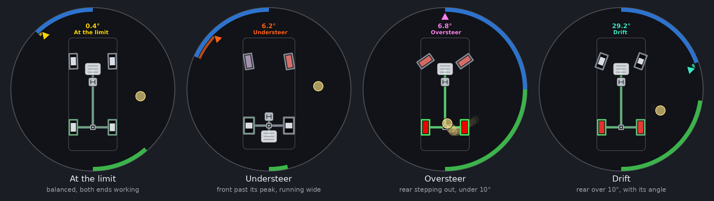
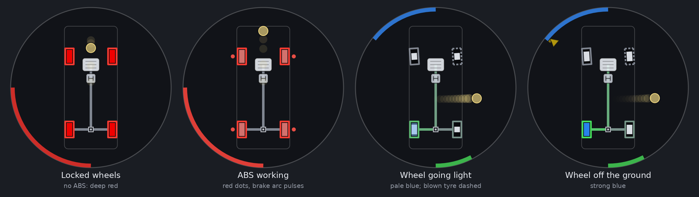
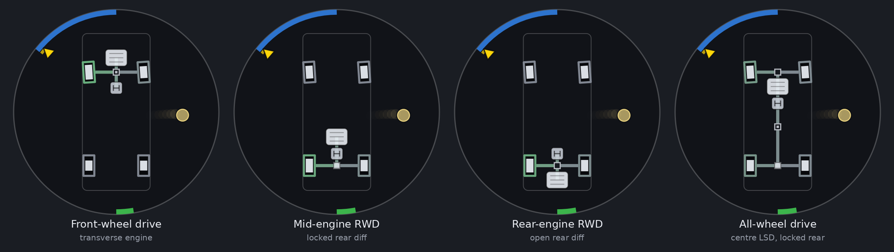
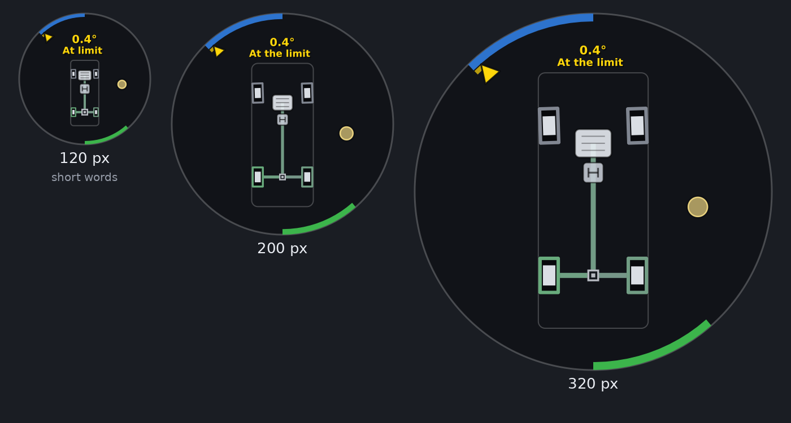

# VGS Display for Assetto Corsa

**Version 1.20**

A live grip display for Assetto Corsa, ported from the BeamNG.drive version (2.5) and inspired by the VGS (Vehicle Gravity System) in Enthusia Professional Racing. It shows what a simulator can't let you feel: how hard each tyre is working, when one lets go and how badly, where the car is really going against where you're steering, and whether it's the front or the rear that's giving up.

It's a Custom Shaders Patch (CSP) Lua app. The picture and colours are the BeamNG version's. Where AC reports things differently, the app reads what AC has. [What's different from the BeamNG version](#whats-different-from-the-beamng-version) lists every change.

Every readout in 1.0 was checked against the exact values in a vehicle simulation: 22 cars, nearly 700 runs. [How it was tested](#how-it-was-tested) has the numbers.

## Install

1. You need Assetto Corsa with **Custom Shaders Patch** (any recent version with Lua apps).
2. Copy the `VGSDisplay` folder to `assettocorsa/apps/lua/`, so you have `assettocorsa/apps/lua/VGSDisplay/manifest.ini`. With Content Manager you can drag the zip onto it instead.
3. In a session, open the app bar on the right of the screen and switch on **VGS Display**.
4. Move it and resize it to taste. The circle always fills the window.

The cog on its title bar opens the settings: engine position, whether to draw the drivetrain, how see-through the background is, and a diagnostics panel.

The window has no background of its own (and so no blur behind it): only the circle is drawn, at 62 % opacity as in the BeamNG version. Hover over it to bring up its title bar, to move it or open the settings.

It shows the car the camera is on, so it works in replays and while spectating too.

## Reading it at a glance

| You see | It means |
|---|---|
| White bar growing out from the middle of a tyre | That tyre is working: the taller the bar, the more of its grip is in use |
| A tyre filled solid pink | It's just past its limit. Ease off now and it comes back |
| A tyre filled solid deep red | It's well past the limit: sliding, locked or spinning |
| A tyre turning pale blue | It's nearly off the ground |
| A tyre filled blue | It's off the ground |
| Dashed outline | A blown tyre |
| Green outline on a tyre | Drive torque is going through it: the brighter, the more of the tyre's grip the drive is using |
| Red outline on a tyre | It's being braked (brakes or engine braking): the brighter, the more of its grip the braking is using |
| Blue arc from the top of the rim | Steering input |
| Wedge just inside the steering arc (only when the car is off balance) | How much the car is actually turning. Yellow: one end, or both, is nearing its limit. Orange-red: understeer. Pink-magenta: oversteer, the rear stepping out (or a spin). Aquamarine: a drift (the rear over 10° at more than 20 km/h), or an all-wheel-drive powerslide you're holding. [The balance](#the-balance) says exactly when each shows |
| Red arc from the bottom, towards the left | Brake pedal (pulses while ABS works) |
| Green arc from the bottom, towards the right | Throttle (pulses darker while traction control cuts power) |
| Thin white arc along the edge, over the throttle | Clutch pedal |
| Thin wine-red arc along the edge, over the brake | Handbrake |
| Yellow dot and trail | The G-force you feel, and where it's been for the last 1.3 s |
| Small red dot beside a wheel | ABS is working on that wheel |
| Small green dot on the engine | Traction control is cutting power |

The direction marker, the steering scale (stretched around the centre, more so with speed), the state colours and the powerslide rule work as in the BeamNG README. That README has the details. The arcs for the steering, throttle, brake, clutch and handbrake start on an exactly vertical line through the centre of the circle.

## The balance

Each end of the car is judged by its own tyres. AC reports every tyre's normalised slip (`ndSlip`), where 1 is the peak of that tyre's grip curve. The app takes each axle's, weighted by the load on each tyre:

| State | When it shows |
|---|---|
| **Front near limit** (yellow) | The front's `ndSlip` at 0.6 or more (60 % of the way to its peak), and nearer the peak than the rear |
| **Rear near limit** (yellow) | The rear's `ndSlip` at 0.6 or more, and nearer the peak than the front |
| **At the limit** (yellow) | Both ends at 0.6 or more, within 0.15 of each other |
| **Understeer** (orange-red) | The front **past** its peak (`ndSlip` over 1), and further past it than the rear. More steering won't turn the car more |
| **Oversteer** (pink-magenta) | The rear **past** its peak and stepping out: its tyres slipping at a bigger angle than the front's (2° more), in the direction the car is turning. A spin (past 120°) is oversteer too |
| **Drift** (aquamarine) | The rear tyres' slip angle over 10° at more than 20 km/h. See [Drift](#drift) |

The near-limit warnings and understeer need the car to be turning (a yaw rate of 0.05 rad/s, about 3°/s), and oversteer 0.1 rad/s. Below 7 m/s (25 km/h) the limits fade out, and under 4 m/s they aren't judged. Each state has a little hysteresis, so it doesn't flicker on and off at the edge.

The marker then holds a lesser state for 0.2 s before dropping to it, and confirms a drift for 0.1 s (it shows oversteer until then).

## Drift

Drift detection uses the rule from Damgam's **Drift Scoring** app:

- **The drift angle** is the rear tyres' slip angle as AC reports it (the larger of the two, from the wheels on the ground).
- **It's a drift** when that angle is over **10°** at more than **20 km/h**. Braking or the handbrake doesn't stop it counting.
- **Going backwards**, the angle is measured from the other end (180° minus the slip angle), as in Drift Scoring.
- **Past 120°** it's a spin, not a drift, and the marker goes back to pink (oversteer).
- **Through a transition** the angle passes through zero when you flick from one direction to the other. The drift is held for **0.5 s** so the colour doesn't drop out. It ends at once if you spin or drop under 20 km/h.

While drifting, the marker and its band are aquamarine, and the [balance readout](#the-balance-readout) shows **Drift** with the drift angle, like Drift Scoring's angle meter.

A rear stepping out by less than 10°, or a slide below 20 km/h, is still oversteer (pink). Drift Scoring's off-track, direction-of-lap and scoring rules don't apply here: a slide on the grass is still a slide.

This replaces the BeamNG version's "controlled drift" test, which also wanted the front wheels pointing almost exactly where the front was going and the slide not growing. That was too strict: it hardly ever showed.

## Drivetrain

Under the wheels: the engine, gearbox, differentials and shafts, tinted green while they carry drive and red under engine braking.

- **Drive layout** comes from the car (front, rear or all-wheel drive).
- **Differentials** come from the car's `drivetrain.ini` (packed `data.acd` files too). A hollow square is open, a square with a centre block is limited-slip, and a solid square is locked (a spool). All-wheel-drive cars also get a centre differential, from the `[AWD]` section.
- **Engine position**: AC doesn't record where a car's engine sits. Front-wheel-drive cars get a transverse engine at the front. For the others the app looks, in order, at:
  1. the car's tags (`ui_car.json`), if they say "mid-engine", "rear-engine", "MR", "RR" or the like;
  2. its maker and model (folder name and display name), against a table of the models that aren't front-engined (the Kunos ones among them, with the Porsche 911 GT1 and 2017 RSR as the mid-engined 911s they are) and of front-engined ones with their weight far enough back to fool the weight rule (Ferrari F12 and 812, Mercedes SLS and AMG GT, and so on);
  3. its description, if it names one position only;
  4. the weight distribution (`CG_LOCATION` in `suspensions.ini`): a front engine from 47 % of the weight on the front, a mid engine from 40 % to 47 %, and a rear engine below 40 %.

  The weight alone can't tell a mid-engined Lotus (38 % on the front) from a rear-engined Porsche 911 (39 %), or a front-engined Ferrari F12 (46 %) from a mid-engined Cayman (45 %). On 248 real cars (most of the Kunos cars and many others, with their weight distributions approximated; 56 of them checked only after the table was written), the weight alone placed 90 % right and the four steps together all of them. The settings' diagnostics say which step placed it. If it's still wrong for a car, pick the position in the settings.

## The balance readout

Above the car, whenever the marker shows a state: the state in words, in the marker's colour, with an angle above it. For the near-limit, at-the-limit, understeer and oversteer states, the angle is how many degrees more one axle is slipping than the other (to within about 0.3° in the tests). For a drift it's the drift angle, and for a powerslide the rear tyres' slip angle. With the car within its grip, nothing is shown. The angle is averaged over 150 ms so it can be read.

The car is drawn a little smaller and lower to make room for it. In a small app (under about 125 px across, or wherever the full words would squeeze the car too much) the words are shortened: *Front near*, *Rear near*, *At limit*, *Under*, *Over*.

## What's different from the BeamNG version

AC reports some things BeamNG doesn't, and the other way round.

**Better in AC:**

- **The grip bar isn't an estimate.** AC reports each tyre's normalised slip (`ndSlip`), where 1 is the peak of that tyre's own curve. The grip bar and the "past the limit" test use it directly. BeamNG needed a force-and-slip-speed estimate tuned by `MU_NOMINAL`, `SLIP_PEAK` and `SLIP_LIMIT`.
- **How near each end is to its limit** is each axle's `ndSlip`, weighted by load. This replaces the cornering-stiffness model, which needed BeamNG's calibration files or a few seconds of learning, so it works from the first corner on every car.
- **No delay between the physics and the picture.** The app reads the car and draws in the same frame. The BeamNG version's motion smoothing between updates isn't needed.

**Read differently:**

- **Torque on the outlines** comes from each tyre's slip ratio: what it's actually being asked to transmit. It's shown as the share of the tyre's grip the drive or braking is using: the slip ratio against the slip ratio where that axle's tyres peak (learnt while they run straight, from `ndSlip`), through a tyre's usual grip curve. A tyre's grip rises steeply with slip: braking at a third of the peak slip ratio already uses about three quarters of its grip, and now shows as such (it showed a third). Full green or red is the tyre at its peak or past it. Below walking pace the outline follows the brake pedal instead.
- **Shafts**: drive is shown while you're on the throttle, and engine braking while you're off the throttle and the brakes. Under braking the shafts stay grey, because friction braking and engine braking can't be told apart.
- **The slide colour** uses the same slip-ratio scale as BeamNG (pink up to 30 %, deepest red at 100 %), worked out from the tyre's slip ratio and slip angle.
- **Signs are learnt, not assumed.** Which way the steering input points, the yaw rate's sign and the slip ratio's sign are each checked against the car's own motion within the first moments of driving. The diagnostics panel shows what was learnt.
- **No numbers mode.** The [balance readout](#the-balance-readout) is always on. There are no grip or weight figures by the tyres.
- **The steering's full lock** is read from `car.ini` (the steering wheel's lock over the rack's ratio), so the direction marker's scale is right from the first frame. The BeamNG version learnt it, and the AC port did until 1.0.

**Not available in AC:**

- **ESC dots.** AC has no per-wheel stability control.
- **ABS dots** go on the wheels ABS is holding at braking slip while it works. AC says ABS is working, but not on which wheel.
- **Traction control** is an engine power cut in AC, so it's a green dot on the engine, as for the BeamNG classic script.
- **Trailers, dual tyres, broken-off wheels and disconnectable shafts.** Cars in AC always have four wheels and a fixed drivetrain.
- **Live diff lock state.** The diff type is read from the car's files, so a setup change to the diff's power or coast doesn't show.

## Settings you can change

In the app's settings window: engine position, whether to draw the drivetrain, and the background's opacity (0 % is fully see-through, 100 % solid; 62 % by default). The diagnostics there show what the app has read and learnt about the car: its layout, where the engine position came from, the full lock, each axle's peak slip ratio, the signs, and the live balance.

The rest are constants at the top of `src/telemetry.lua` (the `TUNE` table) and `src/render.lua`. Most keep their BeamNG names and meanings. The AC-specific ones:

| Setting | Default | What it does |
|---|---|---|
| `SLIDE_ON` / `SLIDE_OFF` | 1.0 / 0.85 | `ndSlip` above which a tyre counts as past its limit, and below which it grips again |
| `NEAR_ON` / `NEAR_OFF` | 0.60 / 0.50 | An axle's `ndSlip` from which it's near its limit (the yellow warning), and below which it's clear. Lower warns earlier |
| `PAST_ON` / `PAST_OFF` | 1.0 / 0.92 | An axle's `ndSlip` from which it's past its peak (understeer at the front, oversteer at the rear), and below which it's back under it |
| `US_LEAD` / `US_LEAD_OFF` | 0.10 / 0.06 | Understeer: how much further past its peak the front must be than the rear, and below which it's over |
| `OS_EXCESS` / `OS_EXCESS_OFF` | 0.035 / 0.02 | Oversteer: how much bigger (radians) the rear tyres' slip angle must be than the front's, and below which it's over |
| `TURN_MIN_YAW` / `OS_MIN_YAW` | 0.05 / 0.10 | Yaw rate (rad/s) the car must be turning at for the warnings and understeer, and for oversteer |
| `SR_PEAK` | 0.12 | Peak slip ratio assumed for a tyre's outline until the car's own is learnt (in a few moments of straight-line driving or braking) |
| `TYRE_SHAPE_C` | 1.45 | Shape of the grip curve the outline's share of grip is read through |
| `SR_ABS` | 0.04 | Braking slip ratio from which a wheel gets the ABS dot while ABS works |
| `DRIFT_MIN_ANGLE` / `DRIFT_MAX_ANGLE` | 10 / 120 | Rear slip angle (degrees) from which it's a drift, and past which it's a spin |
| `DRIFT_MIN_SPEED` | 20 | km/h a drift must be faster than |
| `DRIFT_HOLD` | 0.5 | Seconds a drift is held after the angle drops (through a transition) |
| `MID_ENGINE_BELOW` / `REAR_ENGINE_BELOW` | 0.47 / 0.40 | Weight on the front below which the engine is placed mid or rear, when nothing else says where it is |
| `GF_WINDOW` / `GF_MIN_CUTOFF` | 0.05 / 1.2 | The G-force dot's smoothing: the time its acceleration is measured over (at least three frames), and its filter's slowest cutoff (Hz) |

The table of models that place the engine is in `src/carinfo.lua`. Add a car to it if one is placed wrong.

After editing, restart the session, or close the app and open it again. It's fully unloaded when closed.

## Troubleshooting

**The circle says "waiting for car".** No car data yet. It should go once you're in the car.

**The circle says "error".** Something in the app failed. The settings window shows the last error, and it's also in CSP's Lua debug log. Please send it over.

**The warnings come too early or too late for a car.** Drive a steady corner with the settings window open and watch *Near limit (ndSlip)* for the front and rear. AC tyre models differ, so `NEAR_ON` may want moving for some cars.

**The engine is in the wrong place.** Pick the right position in the settings. The diagnostics show what placed it (tags, name, description or weight).

## How it was tested

This version hasn't run in Assetto Corsa itself yet. Every readout was checked, frame by frame, against the exact values in a vehicle simulation, with the app's own code fed the way AC feeds it.

**The simulation.** A car model with load transfer (and its lag), combined-slip tyres (a Magic Formula curve with a peak and a falloff, load sensitivity, relaxation length), aero downforce, an engine with a torque curve and engine braking, a gearbox with automatic shifts and reverse, a clutch, open, limited-slip (AC's power, coast and preload) and welded differentials, all-wheel-drive centre differentials, brakes with and without ABS, traction control, a handbrake, a steering rack with its lock and hand speed, wheels that lift (jumps, kerbs) and tyres that blow.

**Fed as AC feeds it.** AC's physics runs at 333 Hz, and a Lua app reads the latest physics step once per frame. So the app read the model that way, at 60 frames a second jittering ±15 % (and 30, 144 and a swinging 45-120 in the robustness runs). The velocity it read carried the body's vibration on its springs (about 0.05 g). The truth didn't.

**22 cars**, chosen to spread across every drive layout, engine position and weight balance:

- Front-engined, rear drive: a coupe with a clutch LSD, a light welded-diff car, an open-diff roadster, a 1750 kg muscle car (56 % on the front), a front-mid GT (47 %, with ABS and traction control), a soft front-heavy sedan (58 %), and a GT3 car on slicks with aero.
- Mid-engined: a supercar (42 %), a lightweight (38 %), a prototype with big aero, a single-seater, and an all-wheel-drive supercar (30/70).
- Rear-engined: a sports car (39 %), an all-wheel-drive turbo (38 %), and a classic on skinny tyres.
- Front-wheel drive: a hot hatch with an LSD, an economy car with an open diff, and a light, tail-happy hatch.
- All-wheel drive: a 50/50 rally car, a front-engined GT (35/65), and a nose-heavy wagon with open diffs.
- A 2600 kg van with a high centre of gravity.

Tyre peaks from 5° to 10° slip angle and 7 % to 14 % slip ratio, grip from 0.9 to 1.7, weight on the front from 38 % to 64 %.

**456 runs**: each car through flat-out acceleration, hard braking (with and without ABS), half braking, a constant-radius circle at 40 m and 100 m with the speed creeping past the limit, a small and a big step of steering, lifting mid-corner, lifting and braking mid-corner, trail braking into a corner, power out of a corner, turning in too fast, a held 30° drift, a drift with a transition the other way, a handbrake spin, a slalom, full lock at a crawl and reversing, a jump, kerbs, and a blown tyre. Corners both ways.

**176 more** in variants of every car: a wet track, tyres peaking at different slip angles front and rear (both ways round), tyres that fall away sharply or hardly at all past their peak, and strong load sensitivity.

**65 robustness runs**: AC's sign conventions flipped (steering, yaw, slip ratio, all three), frame rates, the app opened mid-corner, a teleport, a pause and a frame hitch, missing fields, no data files, no `car.ini`.

**The truth** is worked out every frame from the model's exact values: each tyre's `ndSlip`, slip ratio, slip angle, load and force; the body's acceleration; each axle's slip angle; and the balance state by the rules in [The balance](#the-balance), with no smoothing and no hysteresis. Frames within a whisker of a threshold, and states lasting under 0.15 s, aren't counted either way.

**Results** (the 456 runs; 2.5-ac2 is the version before 1.0):

| Readout | 2.5-ac2 | 1.0 |
|---|---|---|
| Balance state as drawn, agreeing with the truth | 93.0 % of frames | 97.1 % |
| Understeer as drawn: right when it's shown | 90.6 % | 95.5 % |
| Understeer onset, 90 % of the time within | 112 ms | 36 ms |
| Oversteer (not a drift), from the app's state: shown when it's there / right when shown | 70 % / 35 % | 95 % / 98 % |
| Oversteer onset, 90 % of the time within | 184 ms | 33 ms |
| Front near limit, shown as such (not as understeer) | 80 % | 91 % |
| Drift drawn after it starts (median) | 207 ms | 108 ms |
| Engine position, 248 real cars | 90 % | 100 % |
| Steering's full lock, error | 7 % (37 % in 1 run in 20) | 0 |
| G-force dot, error | 0.080 g | 0.066 g |
| G-force dot, lag | 117 ms | 83 ms |
| Torque outline, error (share of grip) | 0.12 | 0.05 |
| Grip bar, error (share of the peak) | 0.037 | 0.029 |
| Direction marker, error (road-wheel degrees) | 0.28° | 0.15° |
| Axle slip angles (the balance readout), error | 0.42° front, 0.51° rear | 0.29°, 0.29° |
| Wheel steering angles, drawn wheel positions and tyre sizes | exact | exact |
| Pedals (to the whole percent), steering input, drift angle | exact | exact |

The variants agreed as well (balance state 88.6 % before, 95.2 % after; oversteer from 22 % to 93 % found). In the robustness runs every sign was learnt, the app opened mid-corner now reads the steering to within half a degree from the first frame (it was 3.5° off until the wheels were next straight), and a car without `steerLock` now gets its lock from `car.ini`.

**What the simulation can't show.** The model is simpler than AC's, and AC's `ndSlip` is taken at its word (1 = the peak). The G-force dot's smoothing was set against the simulated vibration: on a bumpier track it may want `GF_MIN_CUTOFF` lowered. The real AC run is the final test, and the thresholds above are where to look if something reads early or late.

The test harness (the simulation, the cars, the scenarios and the analysis) is in `vgs_precision_tests.zip`.
