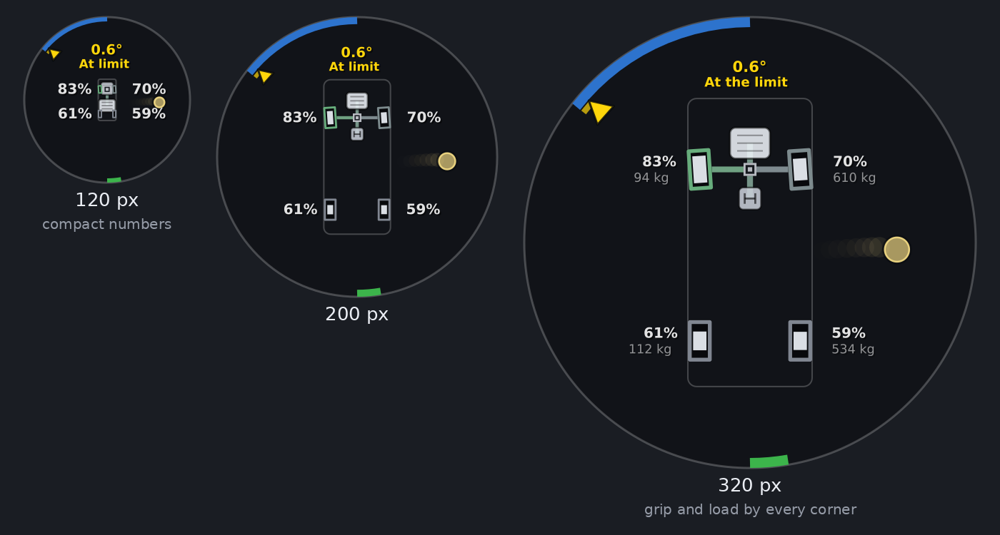

# VGS Display for Assetto Corsa

A live grip display for Assetto Corsa, ported from the BeamNG.drive version (2.5) and inspired by the VGS (Vehicle Gravity System) in Enthusia Professional Racing. It shows what a simulator can't let you feel: how hard each tyre is working, when one lets go and how badly, where the car is really going against where you're steering, and whether it's the front or the rear that's giving up.

It's a Custom Shaders Patch (CSP) Lua app. The picture, colours and rules are the BeamNG version's. Where AC reports things differently, the app reads what AC has. [What's different from the BeamNG version](#whats-different-from-the-beamng-version) lists every change.

## Install

1. You need Assetto Corsa with **Custom Shaders Patch** (any recent version with Lua apps).
2. Copy the `VGSDisplay` folder to `assettocorsa/apps/lua/`, so you have `assettocorsa/apps/lua/VGSDisplay/manifest.ini`. With Content Manager you can drag the zip onto it instead.
3. In a session, open the app bar on the right of the screen and switch on **VGS Display**.
4. Move it and resize it to taste. The circle always fills the window.

**Click the app** to switch numbers mode on or off. The cog on its title bar opens the settings: weight unit, engine position, whether to draw the drivetrain, and a diagnostics panel.

It shows the car the camera is on, so it works in replays and while spectating too.

## Reading it at a glance

| You see | It means |
|---|---|
| White bar growing out from the middle of a tyre | That tyre is working: the taller the bar, the more of its grip is in use |
| A tyre filled solid pink | It's just past its limit. Ease off now and it comes back |
| A tyre filled solid deep red | It's well past the limit: sliding, locked or spinning |
| A tyre turning pale blue | It's nearly off the ground |
| A tyre filled blue | It's off the ground |
| Dashed outline | A blown tyre |
| Green outline on a tyre | Drive torque is going through it |
| Red outline on a tyre | It's being braked (brakes or engine braking) |
| Blue arc from the top of the rim | Steering input |
| Wedge just inside the steering arc (only when the car is off balance) | How much the car is actually turning. Yellow: one end, or both, is nearing its limit. Orange-red: understeer. Pink-magenta: oversteer, the rear sliding. Aquamarine: a drift or an all-wheel-drive powerslide you're holding |
| Red arc from the bottom, towards the left | Brake pedal (pulses while ABS works) |
| Green arc from the bottom, towards the right | Throttle (pulses darker while traction control cuts power) |
| Thin white arc along the edge, over the throttle | Clutch pedal |
| Thin wine-red arc along the edge, over the brake | Handbrake |
| Yellow dot and trail | The G-force you feel, and where it's been for the last 1.3 s |
| Small red dot beside a wheel | ABS is working on that wheel |
| Small green dot on the engine | Traction control is cutting power |

The direction marker, the steering scale (stretched around the centre, more so with speed), the state colours and how long each is held, the G-force smoothing and the drift and powerslide rules all work as in the BeamNG README. That README has the details.

## Drivetrain

Under the wheels: the engine, gearbox, differentials and shafts, tinted green while they carry drive and red under engine braking.

- **Drive layout** comes from the car (front, rear or all-wheel drive).
- **Differentials** come from the car's `drivetrain.ini` (packed `data.acd` files too). A hollow square is open, a square with a centre block is limited-slip, and a solid square is locked (a spool). All-wheel-drive cars also get a centre differential, from the `[AWD]` section.
- **Engine position**: AC doesn't record where a car's engine sits, so it's placed from the weight distribution (`CG_LOCATION` in `suspensions.ini`). Front-wheel-drive cars get a transverse engine at the front. Other cars get a front engine from 47 % of the weight on the front, a mid engine from 40 % to 47 %, and a rear engine below 40 %. If it guesses wrong for a car, pick the position in the settings.

## Numbers mode

By each tyre: its grip in use (100 % is the peak of its curve; above that it's past it) and the weight on it. At the top: the balance in words, in the marker's colour, with how many degrees more one axle is slipping than the other. In a small app (under about 200 px, or wherever the full readouts wouldn't fit) only the grip is shown and the words are shortened. Each number is averaged over 150 ms so it can be read.

## What's different from the BeamNG version

AC reports some things BeamNG doesn't, and the other way round.

**Better in AC:**

- **The grip bar isn't an estimate.** AC reports each tyre's normalised slip (`ndSlip`), where 1 is the peak of that tyre's own curve. The grip bar and the "past the limit" test use it directly. BeamNG needed a force-and-slip-speed estimate tuned by `MU_NOMINAL`, `SLIP_PEAK` and `SLIP_LIMIT`.
- **How near each end is to its limit** is each axle's `ndSlip`, weighted by load. This replaces the cornering-stiffness model, which needed BeamNG's calibration files or a few seconds of learning, so it works from the first corner on every car.
- **No delay between the physics and the picture.** The app reads the car and draws in the same frame. The BeamNG version's motion smoothing between updates isn't needed.

**Read differently:**

- **Torque on the outlines** comes from each tyre's slip ratio: what it's actually being asked to transmit. Full green or red is 12 % slip (`SR_PEAK`). Below walking pace the outline follows the brake pedal instead.
- **Shafts**: drive is shown while you're on the throttle, and engine braking while you're off the throttle and the brakes. Under braking the shafts stay grey, because friction braking and engine braking can't be told apart.
- **The slide colour** uses the same slip-ratio scale as BeamNG (pink up to 30 %, deepest red at 100 %), worked out from the tyre's slip ratio and slip angle.
- **Signs are learnt, not assumed.** Which way the steering input points, the yaw rate's sign and the slip ratio's sign are each checked against the car's own motion within the first moments of driving. The diagnostics panel shows what was learnt.

**Not available in AC:**

- **ESC dots.** AC has no per-wheel stability control.
- **ABS dots** go on the wheels ABS is holding at braking slip while it works. AC says ABS is working, but not on which wheel.
- **Traction control** is an engine power cut in AC, so it's a green dot on the engine, as for the BeamNG classic script.
- **Trailers, dual tyres, broken-off wheels and disconnectable shafts.** Cars in AC always have four wheels and a fixed drivetrain.
- **Live diff lock state.** The diff type is read from the car's files, so a setup change to the diff's power or coast doesn't show.

## Settings you can change

In the app's settings window: numbers mode, weight unit (kg or lb), engine position, and whether to draw the drivetrain.

The rest are constants at the top of `src/telemetry.lua` (the `TUNE` table) and `src/render.lua`. Most keep their BeamNG names and meanings. The AC-specific ones:

| Setting | Default | What it does |
|---|---|---|
| `SLIDE_ON` / `SLIDE_OFF` | 1.0 / 0.85 | `ndSlip` above which a tyre counts as past its limit, and below which it grips again |
| `NEAR_ON` / `NEAR_OFF` | 0.60 / 0.50 | An axle's `ndSlip` from which it's near its limit (the yellow warning), and below which it's clear. Lower warns earlier |
| `PAST_ON` | 1.0 | Front `ndSlip` from which it's past its peak (understeer, when it's also nearer its limit than the rear) |
| `SR_PEAK` | 0.12 | Slip ratio shown as full drive or braking on a tyre's outline |
| `SR_ABS` | 0.04 | Braking slip ratio from which a wheel gets the ABS dot while ABS works |
| `MID_ENGINE_BELOW` / `REAR_ENGINE_BELOW` | 0.47 / 0.40 | Weight on the front below which the engine is placed mid or rear (automatic engine position) |

After editing, restart the session, or close the app and open it again. It's fully unloaded when closed.

## Troubleshooting

**The circle says "waiting for car".** No car data yet. It should go once you're in the car.

**The circle says "error".** Something in the app failed. The settings window shows the last error, and it's also in CSP's Lua debug log. Please send it over.

**The warnings come too early or too late for a car.** Drive a steady corner with the settings window open and watch *Near limit (ndSlip)* for the front and rear. AC tyre models differ, so `NEAR_ON` may want moving for some cars.

**The engine is in the wrong place.** Pick the right position in the settings.

## How it was tested

This port hasn't run in Assetto Corsa itself yet. It was tested outside the game:

- **The API** follows CSP's published Lua SDK and the field names that CSP's own apps and other public Lua apps read. Every field that might be missing in some CSP version is read defensively, so a missing one only switches its feature off.
- **The app's own code** ran under LuaJIT 2.1 (the Lua AC uses) against a mock of CSP's API, driven by a 4-wheel car model with load transfer, combined-slip tyres, wheelspin and ABS. Its drawing calls were turned into the images in this README.
- **The scenarios:**
  - a balanced corner, which reads *at the limit*;
  - hard turn-in on an understeery car: *front near limit*, then *understeer*;
  - a growing slide, a held 30° drift (*controlled drift*), the same drift with the steering 20° off (*oversteer*), and a spin;
  - straight braking with and without ABS;
  - a wheel lifting and a blown tyre;
  - all four drive layouts;
  - app sizes from 120 to 320 px, with and without numbers mode;
  - a car with every optional field missing and no data files;
  - pausing;
  - AC's sign conventions flipped (steering input, yaw rate, slip ratio), to check the app learns them.

  The car model is much simpler than AC's, so the thresholds may want tuning against real cars.
