# VGS Display for Assetto Corsa

*Version 1.20*

A live grip and G-force display for Assetto Corsa, inspired by the VGS (Visual Gravity System) in Enthusia Professional Racing. It shows what a simulator can't let you feel: the G-forces that press you into the seat, how hard each tyre is working, when one lets go and how badly, where the car is really going against where you're steering, and whether it's the front or the rear that's giving up.

> **This is a port.** VGS Display was written for BeamNG.drive, and this app is a port of it to Assetto Corsa as a Custom Shaders Patch (CSP) Lua app. The picture, the colours and the way you read it are the BeamNG version's. Underneath, it reads what AC reports, which is in some ways much more precise than what BeamNG gives, and in others less complete. It also leaves out some of the BeamNG version's features. [A port of the BeamNG version](#a-port-of-the-beamng-version) lists everything that's better, different or missing.

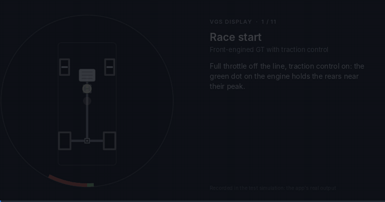

*Above: eleven racing situations, from a race start to a drift, as the app shows them.*

Every wheel is drawn where it sits on the car, with its grip in use, its slide, the torque through it and its steering angle. The drivetrain is drawn underneath, your inputs run around the rim, a G-force dot with a fading trail sits in the middle, and a small marker by the steering arc shows how much the car is actually turning, coloured for understeer and oversteer. When the car is off balance, the top of the circle says how, and by how many degrees.

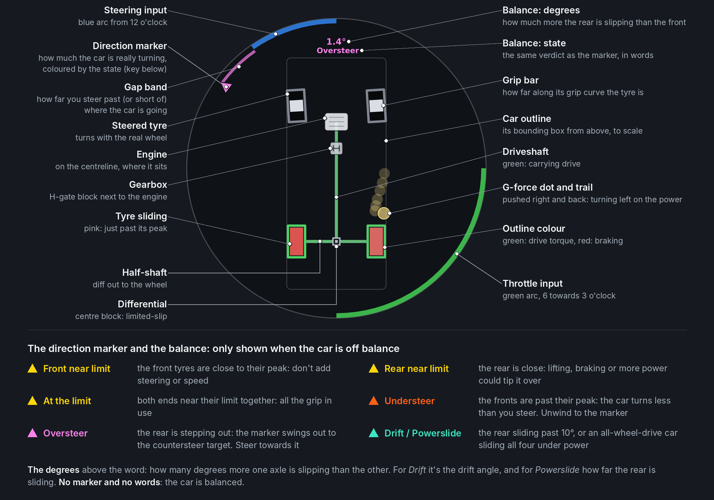

*Above: a front-engined, rear-drive coupé turning left with full throttle in first gear. Both rear tyres have just gone past their peak and the rear is stepping out. The pink-magenta marker has swung out beyond the steering arc, and the readout says oversteer, with 1.4° more slip at the rear than the front. Like every picture of the display in this README, it's the app's own output, fed by a vehicle simulation (see [About the images](#about-the-images)).*

## Contents

**Getting started**
- [What it is, and why](#what-it-is-and-why)
- [Highlights](#highlights)
- [Install](#install)
- [Your first laps: a ten-minute tour](#your-first-laps-a-ten-minute-tour)
- [A port of the BeamNG version](#a-port-of-the-beamng-version)

**Reading the display**
- [At a glance](#at-a-glance)
- [The tyres](#the-tyres)
- [Your inputs on the rim](#your-inputs-on-the-rim)
- [The G-force dot](#the-g-force-dot)
- [The direction marker: understeer and oversteer](#the-direction-marker-understeer-and-oversteer)
- [The balance](#the-balance)
- [The balance readout](#the-balance-readout)
- [Drift](#drift)
- [Powerslide](#powerslide)
- [Driver assists: ABS and traction control](#driver-assists-abs-and-traction-control)
- [The drivetrain](#the-drivetrain)
- [Cars, layout and scale](#cars-layout-and-scale)

**Using it to drive better**
- [How to practise with it](#how-to-practise-with-it)
- [The grip budget](#the-grip-budget)
- [Threshold braking](#threshold-braking)
- [Trail braking, and reading the G trail](#trail-braking-and-reading-the-g-trail)
- [Throttle or brake mid-corner: why the line widens or tightens](#throttle-or-brake-mid-corner-why-the-line-widens-or-tightens)
- [Finding the limit in a steady corner](#finding-the-limit-in-a-steady-corner)
- [Curing understeer](#curing-understeer)
- [Power oversteer: catching a slide](#power-oversteer-catching-a-slide)
- [Lift-off oversteer](#lift-off-oversteer)
- [Drifting](#drifting)
- [All-wheel-drive powerslides](#all-wheel-drive-powerslides)
- [Launches and race starts](#launches-and-race-starts)
- [Kerbs, crests and track limits](#kerbs-crests-and-track-limits)
- [Grip that changes: wet, cold, worn and dirty](#grip-that-changes-wet-cold-worn-and-dirty)
- [Differentials](#differentials)
- [Downforce: fast corners and slow ones](#downforce-fast-corners-and-slow-ones)
- [A lap, corner by corner](#a-lap-corner-by-corner)
- [Learning from ABS and traction control](#learning-from-abs-and-traction-control)
- [Setting up a car with it](#setting-up-a-car-with-it)
- [Replays, spectating and the AI](#replays-spectating-and-the-ai)
- [Common mistakes, and how they look](#common-mistakes-and-how-they-look)

**How it measures**
- [What it reads from AC](#what-it-reads-from-ac)
- [The grip bar and the slide colour](#the-grip-bar-and-the-slide-colour)
- [The torque outline](#the-torque-outline)
- [Wheels off the ground](#wheels-off-the-ground)
- [Steering angles and the direction of travel](#steering-angles-and-the-direction-of-travel)
- [How near each end is to its limit](#how-near-each-end-is-to-its-limit)
- [The G-force measurement](#the-g-force-measurement)
- [Signs, starts and hiccups](#signs-starts-and-hiccups)
- [The engine position](#the-engine-position)

**Reference**
- [Settings you can change](#settings-you-can-change)
- [The diagnostics panel](#the-diagnostics-panel)
- [Compatibility](#compatibility)
- [Troubleshooting](#troubleshooting)
- [Questions and answers](#questions-and-answers)
- [Known limits](#known-limits)
- [Glossary](#glossary)

**About the project**
- [How it was tested](#how-it-was-tested)
- [Changelog](#changelog)
- [About the images](#about-the-images)

---

# Getting started

## What it is, and why

In a real car you drive by the seat of your pants. The G-forces push you into the seat, the belts and the bolsters: back under power, forward under braking, sideways in a corner. They tell you how hard the car is working and where its weight is going, all the time and without looking. They also tell you about the limit. When you add steering and the sideways push stops building, the front has given up. When the push suddenly swings round, the rear is stepping out. And the steering goes light as the front tyres start to slide.

In a simulator, without a motion rig, all of that is gone. You sit still while the car on screen brakes at 1 g. A force-feedback wheel brings back some of the steering's feel, but it can't push you into the seat, and with a pad or keyboard even the steering's feel is gone.

Enthusia Professional Racing (2005) answered that with the VGS, a small diagram of the car that showed the weight moving and the tyres working. This app brings the idea to Assetto Corsa, whose tyre model reports, tyre by tyre, exactly where each one is on its grip curve. So there is a great deal to show:

- **The G-forces you'd feel in the seat**: how hard the car is braking, accelerating and cornering, where the weight is moving, and wheels going light or leaving the ground over kerbs.
- **How hard each tyre is working**, and the moment it goes past its peak.
- **How badly it's sliding**, from "just over" (pink, ease off now) to locked or spinning (deep red).
- **Which end of the car is giving up**: a warning before the front runs wide or the rear lets go, then understeer, oversteer, a drift or a powerslide, with how many degrees it's out by.
- **Where the car is really going** against where you're steering, so you know where to point the wheels to catch a slide.
- **What the car is doing for you**: ABS and traction control, and the drivetrain, live.

AC is built for racing on real tracks, so this README is too. It's a tool for learning to drive at the limit (threshold braking, trail braking, the exit of a corner, catching slides), for understanding a car and its setup, and for seeing why a lap went the way it did. See [Using it to drive better](#using-it-to-drive-better).

## Highlights

- **Every wheel, to scale.** Grip in use, slides graded from "just over the limit" to "locked", drive and braking torque, live steering angle, blown tyres, wheels light or off the ground. Front, rear and all-wheel drive, front-, mid- and rear-engined.
- **Grip from AC's own tyre model.** Each tyre's grip bar is AC's normalised slip (`ndSlip`): how far along its own grip curve the tyre is, 1 being the peak. Nothing is estimated or learnt, so it's right from the first corner on every car, tyre and surface AC models.
- **The G-forces you can't feel.** A G-force dot shows the push you'd feel in the seat, with a trail of where it's been over the last 1.3 s: forward under braking, back under power, across in a corner.
- **Understeer and oversteer you can see.** A direction marker by the steering arc shows how much the car is really turning. It warns in yellow before the front runs wide or the rear lets go, turns orange-red in real understeer and pink-magenta when the rear steps out, and aquamarine in a drift or an all-wheel-drive powerslide. A band shows the gap to your steering.
- **The balance in words and degrees.** Whenever the car is off balance, the top of the circle says so: *Front near limit*, *Rear near limit*, *At the limit*, *Understeer* or *Oversteer* with how many degrees it's out by, *Drift* with the drift angle, or *Powerslide*.
- **Drift detection from Drift Scoring.** A drift is detected with the rule from Damgam's Drift Scoring app, and its angle is the one Drift Scoring's meter shows.
- **No delay to speak of.** The app reads the car and draws it in the same frame.
- **Any car on track.** It shows the car the camera is on: yours, an AI car, another driver online, or any car in a replay.
- **Checked against the physics.** Every readout in 1.0 was checked, frame by frame, against the exact values in a vehicle simulation: 22 cars through nearly 700 runs. See [How it was tested](#how-it-was-tested).

## Install

1. You need Assetto Corsa with **Custom Shaders Patch** (any recent version with Lua apps).
2. Copy the `VGSDisplay` folder to `assettocorsa/apps/lua/`, so you have `assettocorsa/apps/lua/VGSDisplay/manifest.ini`. With Content Manager you can drag the zip onto it instead.
3. In a session, open the app bar on the right of the screen and switch on **VGS Display**.
4. Move it and resize it to taste:
   - The circle always fills the window, so a bigger window means a bigger diagram. The default is 260 × 260 pixels.
   - For learning, a big window near the middle of your view (350–450 pixels, just below the horizon or over the dashboard) is easiest to read without taking your eyes off the track for long. Once you know it, a smaller one in a corner is enough to catch the colours out of the corner of your eye.

The window has no background of its own (and so no blur behind it): only the circle is drawn, at 62 % opacity as in the BeamNG version. Hover over it to bring up its title bar, to move it or open the settings (the cog). The settings hold the engine position, whether to draw the drivetrain, how see-through the background is, and a diagnostics panel.

To update, replace the folder. To remove it, delete the folder.

## Your first laps: a ten-minute tour

The quickest way to learn the display is to make it show each of its states once, on purpose. A practice session with an ordinary rear-drive road car (the BMW M3 E30 or the Toyota GT86 are good) on a track with a slow hairpin and a long straight will do. Turn the traction control off, and the ABS too if the car lets you.

1. **Watch the inputs.** Steer, brake, accelerate: blue arc from the top, red from the bottom towards the left, green from the bottom towards the right. The yellow dot moves forward under braking, back under power, and across in a turn.
2. **Brake hard in a straight line** from about 150 km/h at the end of the straight. The front bars fill. Squeeze harder until a front tyre turns pink, then deep red: that's a lock-up. With ABS on, the brake arc pulses and small red dots appear by the wheels instead.
3. **Take the hairpin a little faster each lap.** The bars grow, then a yellow marker appears by the steering arc: *Front near limit* (or *Rear near limit* in a tail-happy car). Add more steering and it turns orange-red: *Understeer*. Unwind the steering to the marker and it clears.
4. **Add full throttle at the apex** in second gear. The rear bars fill and turn pink, and the marker swings out in pink-magenta: *Oversteer*. Once the rear is sliding past 10°, it turns aquamarine: *Drift*, with the drift angle on top. Steer towards the marker (opposite lock) and ease the throttle to bring it back.
5. **Launch hard from the pit exit** or a standing start. The rear tyres go pink or red as they spin. Find the throttle where they just stay white or pale pink: that's the quickest start.
6. **Ride a kerb.** A wheel that leaves the ground turns blue; one that's nearly off it turns pale blue.

Each of these is explained, with pictures, in [Using it to drive better](#using-it-to-drive-better).

## A port of the BeamNG version

VGS Display began in BeamNG.drive. This app started as a port of the BeamNG version's 2.5 development build, and has followed the later BeamNG releases where they apply to AC: one display mode with the balance always shown (BeamNG 1.10), and *Powerslide* in place of *Controlled powerslide* (BeamNG 1.02). The two have their own version numbers and changelogs.

The two games are very different. BeamNG is a soft-body sandbox: any vehicle, from a city car to a tractor-trailer, on any surface, with every node and beam simulated, but it doesn't say how near its tyres are to their limit. AC is a racing simulator: four-wheeled cars on race tracks, with a tyre model that reports each tyre's slip against its own peak, but much less about the car's mechanical insides. So some things are better in this port, some are worked out differently, and some are missing.

**Better in AC:**

- **The grip bar isn't an estimate.** AC reports each tyre's normalised slip (`ndSlip`), where 1 is the peak of that tyre's own grip curve. The grip bar and the "past the limit" test use it directly. BeamNG reports no such figure, so the BeamNG version estimates each tyre's force against a grip it has to learn (`MU_NOMINAL`, `SLIP_PEAK`, `SLIP_LIMIT`), and reads high or low on a new surface until the car has been near its limit there.
- **How near each end is to its limit** is each axle's `ndSlip`, weighted by load. BeamNG's version works it out from a cornering-stiffness model, which needs BeamNG's stability-control calibration or a few seconds of learning on each car, and has known weak spots (very tall vehicles, tandems, a trailer pulling on the hitch). Here it works from the first corner on every car, and changing grip (rain, cold or worn tyres, a dirty line) needs no relearning.
- **Slip angles and slip ratios come from the tyre model**, wheel by wheel. The drift angle is AC's own rear-tyre slip angle; the slide colour comes from each tyre's slip ratio and slip angle.
- **No transport delay.** The app reads the car and draws it in the same frame, from AC's physics at 333 Hz. The BeamNG version sends each frame from the vehicle's Lua to the UI, and carries moving parts on between updates to make up for the trip.
- **The steering's full lock** comes from the car's `car.ini`, so the steering scale and the direction marker are right from the first frame. The BeamNG version learns it.
- **Any car on track.** It follows the camera: an AI car, another driver online, any car in a replay. The BeamNG version shows the vehicle you're driving (and what's coupled to it).

**Worked out differently:**

- **The grip bar shows slip, not force.** AC's `ndSlip` is how far along its curve the tyre is, and a tyre makes most of its force early on that curve: half a bar is already about 90 % of the tyre's grip, and the near-limit warning at 0.6 is about 94 %. BeamNG's bar is the force against the grip, so it reads fuller earlier. Full means the peak in both. See [The grip bar and the slide colour](#the-grip-bar-and-the-slide-colour).
- **Understeer, oversteer and the warnings** are judged on each axle's `ndSlip` against fixed thresholds, not on a stiffness model. *Understeer* is the front past its peak and further past it than the rear; *Oversteer* is the rear past its peak and slipping at a bigger angle than the front. See [The balance](#the-balance).
- **A drift is Drift Scoring's rule:** the rear tyres sliding at more than 10° above 20 km/h. The BeamNG version's "controlled drift" also wanted the front wheels pointing almost exactly where the front was going and the slide not growing; it was too strict to show often. Here *Drift* means the rear is sliding past 10°, held or not, and a spin past 120° is oversteer again.
- **The torque outline** comes from each tyre's slip ratio, against the slip ratio where that axle's tyres peak (learnt while you drive). BeamNG reports the drive and brake torque on each wheel directly. See [The torque outline](#the-torque-outline).
- **Shafts** show drive while you're on the throttle, and engine braking while you're off the throttle and the brakes. Under braking they stay grey, because friction braking and engine braking can't be told apart from the slip.
- **The direction of travel** comes from the car's velocity and yaw rate (AC's chassis is rigid). BeamNG's comes from the hub nodes' movement.
- **The engine position** isn't in AC's data. It's placed from the car's tags, its maker and model, its description, or its weight distribution. See [The engine position](#the-engine-position).
- **Signs are learnt, not assumed.** Which way the steering input points, the yaw rate's sign and the slip ratio's sign are each checked against the car's own motion within the first moments of driving.
- **Timing.** The marker holds a state for 0.2 s before easing to a milder one (0.45 s in BeamNG), and a drift turns aquamarine after 0.1 s (0.2 s in BeamNG), so states show and clear sooner.

**Missing compared with the BeamNG version:**

- **ESC.** AC has no per-wheel stability control, so there are no blue ESC dots, and no throttle pulse for ESC cutting power.
- **Per-wheel traction control.** AC's traction control cuts engine power, so it's a green dot on the engine, as for the BeamNG version's classic script. There are no green dots by the wheels.
- **Which wheel ABS is working on.** AC says ABS is working, but not on which wheel. The red dots go on the wheels ABS is holding at braking slip while it works, which is nearly always right but is worked out, not reported.
- **Live differential lock state.** The diff types are read from the car's files, so a setup change to the diff's power, coast or preload doesn't change the drawing, and there are no selectable lockers or active diffs.
- **The detailed drivetrain.** No hybrid motors, transfer cases, disconnectable shafts or broken driveshafts: an AC car is drawn as one engine, a gearbox, and its axle and centre diffs.
- **Other vehicles.** No trailers, coupled vehicles, trucks, dual tyres, three-wheelers or broken-off wheels: AC cars have four wheels. A blown tyre is shown (dashed), as the BeamNG version shows a flat one.
- **Console commands.** There's no Lua console to type into. The settings window's [diagnostics panel](#the-diagnostics-panel) shows the figures `dumpTravel` prints in BeamNG.
- **The BeamNG 1.20 latency work.** BeamNG's 1.20 G-force dot takes its sideways part from speed × yaw rate, which follows a turn-in about 35 ms behind the true force. This port still measures the dot from the slope of the velocity, about 80 ms behind (see [The G-force measurement](#the-g-force-measurement)). Its grip bars and marker don't need BeamNG's other 1.20 changes, since they come straight from AC's values.

---

# Reading the display

## At a glance

| You see | It means |
|---|---|
| White bar growing out from the middle of a tyre | That tyre is working: the taller the bar, the further along its grip curve it is. Full is the peak |
| A tyre filled solid pink | It's just past its peak. Ease off now and it comes back |
| A tyre filled solid deep red | It's well past its peak: sliding, locked or spinning |
| A tyre turning pale blue | It's nearly off the ground: carrying little of its normal load |
| A tyre filled blue | It's off the ground |
| Green outline on a tyre | Drive torque is going through it: the brighter, the more of the tyre's grip the drive is using |
| Red outline on a tyre | It's being braked (brakes or engine braking): the brighter, the more of its grip the braking is using |
| Dashed outline | A blown tyre |
| Blue arc from the top of the rim | Steering input |
| Wedge just inside the steering arc (only when the car is off balance) | How much the car is actually turning, as a steering angle, with a band in its colour back to the end of the steering arc. Yellow: a warning, one or both ends nearing their limit. Orange-red, with the steering well past it: understeer. Pink-magenta, swung out beyond the steering: oversteer, the rear stepping out (or a spin). Aquamarine: a drift, or an all-wheel-drive powerslide you're holding |
| Degrees and a word at the top of the circle | The balance: which end is near or past its limit and by how many degrees, or a drift's angle |
| Red arc from the bottom, towards the left | Brake pedal (pulses brighter while ABS works) |
| Green arc from the bottom, towards the right | Throttle (pulses darker while traction control cuts power) |
| Thin white arc along the edge, over the throttle | Clutch pedal |
| Thin wine-red arc along the edge, over the brake | Handbrake |
| Yellow dot and trail | The G-force you feel, and where it's been for the last 1.3 s |
| Small red dot beside a wheel | ABS is working on that wheel |
| Small green dot in the middle of the engine | Traction control is cutting power |
| Green driveshaft | The engine is driving the wheels at the end of it |

The marker, its band and the words at the top only appear when the car is off balance. A clear rim with no marker means all's well.

## The tyres

| Part of the wheel | Meaning |
|---|---|
| Inner bar, growing from the centre | How far along its grip curve the tyre is: AC's `ndSlip`, 0 to 1 (the peak) |
| Inner bar filled solid, pink to deep red | Past its peak (`ndSlip` over 1): sliding. A greyish pink just past the peak, deepening to saturated red towards a full lock-up or spin |
| Outline grey → green | Drive torque, as a share of the tyre's grip |
| Outline grey → red | Braking torque (brakes, engine braking), as a share of the tyre's grip |
| Rotation | Live steering angle of that wheel |
| Dashed outline | Blown tyre |
| Turning pale blue | Nearly off the ground: the paler, the less load it's carrying (from a quarter of its normal load down to none) |
| Filled blue | Off the ground |
| Small red dot beside it | ABS is working on that wheel |

### Grip bar

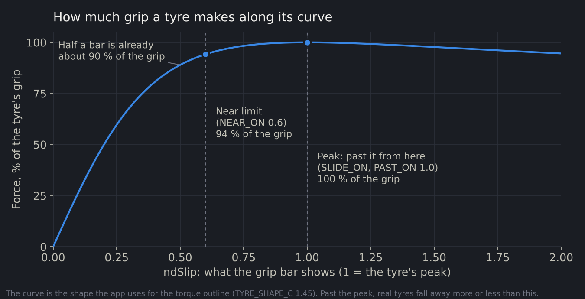

The white bar grows from the middle of the tyre towards both ends. An empty tyre is rolling freely, and a full bar is right at its peak. It counts everything the tyre is doing at once: cornering, braking and driving together (see [The grip budget](#the-grip-budget)).

The bar is AC's own figure, `ndSlip`: the tyre's slip (its slip angle and slip ratio together) against the slip where that tyre's grip curve peaks. So it doesn't need learning or calibrating, and it means the same thing on every tyre and surface: 1 is the peak.

**Read it as "how far along the curve", not "how much force".** A tyre's force rises steeply with slip at first, then flattens towards the peak. Half a bar is already about 90 % of the tyre's grip; 0.6, where the near-limit warning starts, is about 94 %. The last third of the bar is the tyre squeezing out its last few percent. That's what makes the bar useful at the limit: the part of the curve where a little more slip gives almost nothing is spread across a third of the bar, where you can see it.

### Sliding, and how far past the limit

When a tyre goes past its peak (`ndSlip` over 1), its bar fills the whole tyre, and its colour shows how far past it is. It stops counting as sliding once `ndSlip` drops below 0.85, so it doesn't flicker at the edge.

The colour comes from the tyre's **slip ratio**, combined with its slip angle: how fast its contact patch is sliding, against the road speed. 10 % means the tyre surface is moving 10 % faster or slower than the road under it; 100 % means a locked wheel, or one spinning as fast again as the road, or a tyre sliding sideways at 45°. The scale follows how real road tyres behave:

- **Peak grip is at about 10–15 % slip.** This is where threshold braking and a good launch live.
- **Up to about 30 % slip, the tyre is still within a few percent of its best grip.** The display keeps it pink through this band. It's the warning that you're just over the limit, with time to ease off before grip really goes.
- **From 30 % to 100 %, grip falls away** towards a locked or spinning wheel's sliding grip. The red deepens steadily and is fully saturated at 100 %.

So **pale pink is fine, even ideal, for a moment; deep red is always lost time**. Some examples:

| Slip | Shown as |
|---|---|
| 12 % slip ratio | Pale pink: ideal threshold braking |
| 30 % slip ratio, or about 17° sideways | Pink, at the end of the pink band |
| 50 % | Clear red |
| 100 %: locked, or spinning at twice the road speed | Deepest red |

Below 18 km/h the slip ratio is scaled down, so a crawl doesn't show wild colours.

### Outline: torque

The outline shows the drive or braking going through the wheel, as the share of the tyre's grip it's using. It goes from grey, through softer tints, to full green for drive or full red for braking. Full means the tyre is at its peak in that direction (or past it).

- **Green:** drive torque, the tyre pushed forwards.
- **Red:** braking torque, from the brakes or from engine braking.

A tyre's force rises steeply with slip, so braking at a third of the peak slip ratio already uses about three quarters of the tyre's grip, and shows as such. How it's worked out: [The torque outline](#the-torque-outline).

### Steering, blown and airborne wheels

- **Steering:** each tyre turns with its real steering angle, measured from the wheel's heading against the car's. Straight ahead is taken while the steering is centred, so static toe reads as straight ahead.
- **Blown:** the outline turns dashed but keeps its torque colour and grip bar, since the wheel still rolls and drives (AC's `isBlown`).
- **Nearly off the ground:** as a wheel's load falls below a quarter of its normal load, its inside turns pale blue, a lighter shade of the off-the-ground blue, growing stronger until it's solid pale blue just before the wheel lifts. That's an inside wheel in a hard corner, a wheel cresting a rise, or one riding up a kerb. The load is smoothed a little, so a bump gives at most a faint tint, and the normal load is followed slowly while the wheel is properly loaded, so it adapts to the car, its fuel load and its downforce.
- **Off the ground:** a wheel carrying less than 150 N has no grip and can't count as sliding. It's *shown* off the ground only once it has carried that little for a quarter of a second, so a wheel skipping over a sausage kerb for a frame or two doesn't flash blue. Until then the grip bar and slide colour hold what they showed. It's back on the ground as soon as it carries twice that load.

## Your inputs on the rim

Around the rim of the circle are your inputs, each filling up to a quarter turn at full input:

| Arc | Meaning |
|---|---|
| Blue, from 12 o'clock | Steering: grows towards 9 o'clock turning left, towards 3 o'clock turning right; a full quarter at full lock. The scale is stretched around the centre, so the few degrees you steer at speed are easy to read (see below). The small corrections of driving straight don't show: the arc fades in between about 0.55 % and 1.2 % of steering in slow corners, and between about 0.25 % and 0.55 % from about 80 km/h up. So the rim stays clean on a straight at any speed |
| Wedge just inside the steering arc | How much the car is turning, on the same scale as the steering; see [The direction marker](#the-direction-marker-understeer-and-oversteer) |
| Red, from 6 o'clock towards 9 | Brake pedal |
| Green, from 6 o'clock towards 3 | Throttle pedal |
| White, from 6 o'clock towards 3, half as wide along the outer edge | Clutch pedal (a full quarter with the pedal fully down), drawn over the throttle |
| Wine red, from 6 o'clock towards 9, half as wide along the outer edge | Handbrake, drawn over the brake |

Every arc starts on an exactly vertical line through the centre of the circle.

### What the pedal arcs show exactly

The pedals are the values AC reports for the car (`gas`, `brake`, `clutch`, `handbrake`), turned into whole percent with the same rounding as the BeamNG version (and BeamNG's own pedals app). That rounding only shows 0 % for exactly zero and 100 % for exactly full: a pedal that's barely touched shows at least 1 %, and one that doesn't quite reach the end stops at 99 %. So a controller deadzone, or a pedal that never fully releases, shows as a sliver of arc. These are the values the car gets: an automatic clutch working by itself, or a blip on a downshift, shows too. Nothing is drawn when an input is at rest.

### The steering scale

At track speeds the road wheels only turn a degree or a few, which on a straight scale would be a sliver of rim, with the direction marker almost at 12 o'clock. So the steering arc and the marker share a scale that's stretched around the centre and compressed towards full lock (`asinh(k·x) / asinh(k)`), and the stretch grows with speed.

The app works out how much steering a 1 g corner needs at the current speed, from the car's wheelbase (plus a little for normal tyre slip) and its full lock, and sets the stretch so that much steering fills 60 % of the quarter (`STEER_TARGET`). Below about 55 km/h it stays at its low-speed minimum (`STEER_EXPAND`), and full lock is always exactly a quarter turn. For a typical car (2.7 m wheelbase, 31.5° full lock at the road wheels):

| Speed | Stretch | 0.5° of road-wheel angle | 1° | 2° | 4° | Half lock |
|---|---|---|---|---|---|---|
| Straight scale, any speed | none | 1° of rim | 3° | 6° | 11° | 45° |
| Up to 54 km/h | 20 | 8° | 15° | 26° | 41° | 73° |
| 90 km/h | 79 | 19° | 29° | 41° | 53° | 78° |
| 126 km/h | 185 | 27° | 38° | 48° | 59° | 79° |
| 180 km/h | 337 | 33° | 42° | 52° | 61° | 80° |
| 250 km/h | 400 (the most) | 34° | 44° | 53° | 62° | 81° |

Because both use the same scale, what matters is never the arc's length on its own, but **where the marker sits against the end of the arc**.

## The G-force dot

The **yellow dot** is the G-force you feel:

- Braking pushes it **forward**, accelerating pushes it **back**.
- A left turn pushes it **right**, a right turn pushes it **left**.
- The edge of the circle is 1.5 g (`GF_MAX`). A road car's limit of about 1 g reaches two-thirds of the way out. Anything past 1.5 g is pinned to the edge, which a car with real downforce reaches in fast corners and under heavy braking (see [Downforce](#downforce-fast-corners-and-slow-ones)).
- Where it's been over the last 1.3 s is drawn as a trail of fading copies.
- It's a little see-through, so the part underneath still shows, with a firm rim and a thin dark ring around it.

It's there to show the **weight shifting**, which you can't feel in a simulator: forward onto the front tyres under braking, back under power, across in a corner. It's measured from the change in the car's velocity, so it reads zero when parked on a hill, and it's smoothed so the car's vibration on its springs doesn't shake it. In the simulation it trailed the true force by about 80 ms. How: [The G-force measurement](#the-g-force-measurement).

Two habits make it useful:

- **The grip bars say how far along its curve each tyre is; the dot says how much grip there is.** On a dry track a road car reaches the limit with the dot about two-thirds of the way out; in the wet, with the bars just as full, it's well short of that. See [Grip that changes](#grip-that-changes-wet-cold-worn-and-dirty).
- **The trail shows how smoothly you hand the grip from one job to another.** A dot that sweeps round near the edge from braking into cornering is using all the grip all the time; one that drops back to the middle between them is wasting it. See [Trail braking](#trail-braking-and-reading-the-g-trail).

## The direction marker: understeer and oversteer

In a simulator you can't feel the car start to slide or the front start to push. So just inside the steering arc, on the same scale, the **direction marker**, a wedge, shows how much the car is actually turning, as a steering angle:

- **While the rear tyres grip** (normal driving, and understeer), the marker sits at the steering that would make the car's current turn if neither end slipped: the wheelbase times the yaw rate, over the speed. It's always on the side the car is turning to, and the gap between it and the steering arc is the understeer: how much more you're steering than the car is turning.
- **Once the rear slides** (oversteer, a drift, a spin), the marker swings towards the outside of the turn, to where the front of the car is actually going. Steering at it points the front wheels exactly where they're travelling: the countersteer target. In a big drift it goes past a quarter turn, and all the way round in a spin.

**The rule of thumb: steer towards the marker.** In understeer, that means less steering; in oversteer, opposite lock.

| What you see | What's happening | What to do |
|---|---|---|
| No marker | The car is balanced: neither end is near its limit | Nothing: that's the sweet spot |
| **Yellow** marker, *Front near limit* | The front tyres are getting close to their peak, before the car actually runs wide | Don't add more steering or speed; this is the warning |
| **Yellow** marker, *Rear near limit* | The rear tyres are getting close to theirs: the car may be about to step out (lifting off, braking or more power now could tip it over) | Be smooth with the pedals and the steering |
| **Yellow** marker, *At the limit* | Both ends are near their limit together: the car is using all its grip | You're at the edge; any more and one end will go |
| Steering arc runs well past the marker, **orange-red** | The front tyres are past their peak and scrubbing: the car turns much less than you steer. **Understeer** | Ease off the steering back towards the marker; more lock won't turn the car |
| Marker beyond the steering arc, then swinging to the outside of the turn, **pink-magenta** | The rear is stepping out: the car is rotating more than you steer. **Oversteer** (or a spin, past 120°) | Follow the marker with opposite lock |
| Marker out on the opposite-lock side, **aquamarine** | The rear is sliding past 10°: **a drift** | Balance it with steering and throttle, or steer to the marker and ease off to end it |
| **Aquamarine**, all-wheel drive, steering into the turn | All four tyres sliding under power, held. **A powerslide** | Keep the power on and steer the car round |

The marker only shows when the car is off balance; while it's neutral it's hidden. Each state has its own strong colour, picked to stay distinct with the common kinds of colour blindness. Yellow is always a warning (the words at the top say which end); the other colours are the car actually doing something.

To make it easy to read at speed:

- **Held long enough to read.** Getting worse (a warning turning into understeer or oversteer, one end's warning becoming both), or switching between understeer and oversteer, shows at once. Easing off (back to a warning, or to neutral) waits 0.2 s, so a quick flick of oversteer stays up long enough to see. A drift turns aquamarine once the slide has been past 10° for 0.1 s.
- **The gap is drawn.** A band in the marker's colour runs between the marker and the end of the steering arc: how far you're steering past where the car is going (understeer), or short of it (oversteer). Its length is the size of the problem.

It fades in within a few frames and out over about a tenth of a second.

**When it shows:** whenever the car is moving, including sliding backwards in a spin. It fades in between 0.5 and 1.5 m/s (2–5 km/h), and it's hidden when you're reversing on purpose, in reverse gear. Straight-line driving stays clear: the states need the car to be rotating.

## The balance

The marker's colour, and the words at the top, come from each axle's grip. AC reports every tyre's `ndSlip`, where 1 is the peak of its grip curve. The app takes each axle's, weighted by the load on each tyre (the heavily loaded outside tyre counts for more), and judges each end by its own tyres:

| State | When it shows |
|---|---|
| **Front near limit** (yellow) | The front's `ndSlip` at 0.6 or more (about 94 % of its grip), and more than 0.15 nearer its peak than the rear |
| **Rear near limit** (yellow) | The rear's `ndSlip` at 0.6 or more, and more than 0.15 nearer its peak than the front |
| **At the limit** (yellow) | Both ends at 0.6 or more, within 0.15 of each other |
| **Understeer** (orange-red) | The front **past** its peak (`ndSlip` over 1), and at least 0.1 further past it than the rear. More steering won't turn the car more |
| **Oversteer** (pink-magenta) | The rear **past** its peak and stepping out: its tyres slipping at a bigger angle than the front's (2° more), in the direction the car is turning. A spin past 120° is oversteer too |
| **Drift** (aquamarine) | The rear tyres sliding at more than 10° above 20 km/h. See [Drift](#drift) |
| **Powerslide** (aquamarine) | All-wheel drive, all four tyres sliding under power, held. See [Powerslide](#powerslide) |

- **Turning.** The warnings and understeer need the car to be turning (a yaw rate of 0.05 rad/s, about 3°/s), and oversteer 0.1 rad/s (about 6°/s), so braking hard in a straight line with the fronts at their limit doesn't show understeer.
- **Hold.** A warning has to last 0.12 s before it shows, so a bump doesn't flash it. Understeer and oversteer show at once.
- **Hysteresis.** Each state clears a little below where it came on (near limit at 0.5, past the peak at 0.92, oversteer below 1.1° more rear slip), so it doesn't flicker at the edge.
- **Low speed.** Below 7 m/s (25 km/h) the limits fade out, and under 4 m/s they aren't judged.

Why load-weighted `ndSlip`: in a corner the outside tyres carry most of the load and do most of the work, so they decide when the axle as a whole runs out. An unloaded inside tyre spinning up, or sliding, counts for little; one carrying nothing counts for nothing.

## The balance readout

Above the car, in the marker's colour, the balance on two lines: in large figures an angle, and under it the state in words. While the car is balanced nothing shows there.

| Words | Colour | Degrees |
|---|---|---|
| *Front near limit* | yellow | how much more the front tyres are slipping than the rear |
| *Rear near limit* | yellow | how much more the rear is slipping than the front |
| *At the limit* | yellow | the difference between front and rear slip |
| *Understeer* | orange-red | how much more the front is slipping than the rear |
| *Oversteer* | pink-magenta | how much more the rear is slipping than the front |
| *Drift* | aquamarine | the drift angle: how far the rear is sliding, as Drift Scoring's angle meter shows it |
| *Powerslide* | aquamarine | how far the rear is sliding |

The slip angles behind the degrees are each axle's, worked out from where its wheels point and where the axle is going (to within about 0.3° in the tests). The angle is averaged over 150 ms (`READ_MS`) so it can be read.

The car is drawn a little smaller and lower to make room for the readout. In a small window (under about 125 pixels across, or wherever the full words would squeeze the car too much) the words are shortened: *Front near*, *Rear near*, *At limit*, *Under*, *Over*.

## Drift

Drift detection uses the rule from Damgam's **Drift Scoring** app:

- **The drift angle** is the rear tyres' slip angle as AC reports it (the larger of the two, from the wheels on the ground).
- **It's a drift** when that angle is over **10°** at more than **20 km/h**. Braking or the handbrake doesn't stop it counting.
- **Going backwards**, the angle is measured from the other end (180° minus the slip angle), as in Drift Scoring.
- **Past 120°** it's a spin, not a drift, and the marker goes back to pink-magenta (oversteer).
- **Through a transition** the angle passes through zero when you flick from one direction to the other. The drift is held for **0.5 s** so the colour doesn't drop out. It ends at once if you spin or drop under 20 km/h.

While drifting, the marker and its band are aquamarine, and the balance readout shows **Drift** with the drift angle, like Drift Scoring's angle meter.

So aquamarine here means "the rear is sliding past 10°", not "you have it under control". A rear stepping out by less than 10°, or a slide below 20 km/h, is oversteer (pink-magenta); past 10° it's a drift until it spins past 120°. Drift Scoring's off-track, direction-of-lap and scoring rules don't apply: a slide on the grass is still a slide. AC's own drift mode scores drifts its own way; this doesn't follow it.

## Powerslide

A powerslide is the all-wheel-drive way of sliding: all four tyres sliding under power, you steering into the corner and the driven front tyres pulling the car round, rather than catching the rear with opposite lock. The front slides nearly as much as the rear, so the oversteer test doesn't see it. It needs:

- both axles driven (an all-wheel-drive car);
- the rear sliding out, from about 6° to 10°;
- the front sliding into the turn too, from about 2° to 4°, but not far more than the rear: 5° to 10° more is ploughing, which is understeer;
- the throttle on, from 20 %, above walking pace;
- the slide holding: growing by up to about 20° a second still counts, and from about 57° a second it's getting away.

Held, it shows aquamarine with *Powerslide* and how far the rear is sliding; getting away, it's oversteer. A rear sliding past 10° counts as a drift whatever the drive, so on an all-wheel-drive car *Powerslide* covers rear slides between about 6° and 10°, and *Drift* takes over beyond.

## Driver assists: ABS and traction control

| Assist | Shown as |
|---|---|
| ABS | The brake arc pulses brighter, and a small red dot sits beside each wheel ABS is holding |
| Traction control | A small green dot in the middle of the engine, and the throttle arc pulses darker |

Both come from AC's own flags (`absInAction`, `tractionControlInAction`), which say an assist is working right now. Nothing is held or averaged: the dots flicker as fast as the assist works. The pulse runs at 5 per second.

AC doesn't say which wheel ABS is working on, so while ABS works (and you're braking), a red dot goes beside each wheel braking at more than 4 % slip ratio (`SR_ABS`): the wheels ABS is holding near their peak. AC's traction control cuts engine power for the whole car, so its dot is on the engine.

AC has no stability control (ESC) in the BeamNG sense, so there are no blue ESC dots. What the dots can teach you: [Learning from ABS and traction control](#learning-from-abs-and-traction-control).

## The drivetrain

Under the wheels: the engine, gearbox, differentials and shafts, tinted green while they carry drive and red under engine braking.

| Part | Drawn as | Where it comes from |
|---|---|---|
| Engine | Light block with ribs | Its position: see [The engine position](#the-engine-position). Front-wheel-drive cars get a transverse engine at the front axle |
| Gearbox | Small block with an H-gate | In line with the engine, on the side facing the driven wheels |
| Axle differential | Small square at the middle of the driven axle | Its type from the car's `drivetrain.ini` (`[DIFFERENTIAL]` `POWER`, `COAST`, `PRELOAD`) |
| Centre differential | Small square on the centreline | All-wheel-drive cars, from the `[AWD]` section |
| Shafts | Lines from the engine to the wheels | Grey → green with drive, grey → red with engine braking |

| Differential | Drawn as |
|---|---|
| Open (no power or coast lock, little preload) | Hollow square |
| Limited-slip (any lock or preload) | Hollow square with a centre block |
| Locked (power and coast lock both 100 %: a spool or welded diff) | Solid square |

The drive layout comes from the car (front, rear or all-wheel drive), and the diff types from its data files (packed `data.acd` files too). The shafts are tinted by the drive or engine braking reaching the driven wheels, as a share of what those tyres can take: drive while you're on the throttle, engine braking while you're off the throttle and the brakes. Under braking the shafts stay grey. The drawing is mapped once per car, so a setup change to the diff isn't shown.

Untick *Show the drivetrain* in the settings to draw just the wheels.

## Cars, layout and scale

Everything is drawn to scale, from the car itself:

- **Wheels** sit at their real positions on the car, captured when the car is first seen. Each tyre is drawn at its real diameter and at 1.5 times its real width so it's easy to see (`TYRE_WIDEN`). A staggered car (wider rears) shows it.
- **The outline** is the car's bounding box from CSP, seen from above.
- **The circle** fills the window. The car is scaled to fit inside it, clear of the input arcs and the balance readout at the top, with room for its tyres at full steering lock.

---

# Using it to drive better

Every driving skill that matters at the limit comes down to one question: **how much of each tyre's grip am I using, and for what?** In a real car you answer it through the G-forces in the seat and the feel of the steering. Here you can see it. This part goes through the classic skills one by one, with what each looks like on the display, what to do, and what going wrong looks like.

The pictures are the app's own output, fed by a vehicle simulation driven through each manoeuvre (see [About the images](#about-the-images)). Each strip reads left to right through one manoeuvre, or side by side as alternatives. The yellow trail behind the G-force dot shows where it's been over the last moment.

## How to practise with it

- **One thing at a time.** Pick one lesson below and repeat it until the display does what you want, before moving on.
- **Use AC's practice and hotlap sessions,** or a track day with traffic off. A track with a big run-off, or a test track, means running wide costs nothing. Practise each skill in left-handers and right-handers.
- **Start with an ordinary road car.** A mid-size rear-drive road car on road tyres, with the assists you'd normally use. Its limits come slowly and loudly. Race cars and slicks reach them faster and more abruptly, and downforce changes them with speed.
- **Make the app big while learning** (350–450 pixels, low in the middle of your view), so you can read it with a glance rather than a stare. Shrink it later.
- **Use the replay.** Your laps are in AC's replay, and the app follows the replay's car (see [Replays](#replays-spectating-and-the-ai)). Watch a corner back slowly: the bars fill, a tyre goes pink, the marker appears, then the car moves.
- **Look at the order of events, not just the end.** Almost every mistake shows up a fraction of a second before the car does anything: a bar filling, pale blue on an inside wheel, a yellow marker. Learning to react to those is the point.

## The grip budget

A tyre can only make so much force, and it's the same budget whether that force turns the car, brakes it or drives it. Engineers draw it as the **friction circle** (or traction circle): the force can point any way, but it can't go past the edge. Use 90 % of the grip to corner, and only a sliver is left for braking; brake at 95 %, and there's almost nothing for steering.

Combining is fine, and fast, as long as the total stays inside the circle: 75 % turning and 62 % braking is about 97 %, because the two add like the sides of a right-angled triangle, not straight. Push both too far and the tyre goes past its peak: it slides.

**On the display**, each tyre's grip bar is its slip in every direction together: cornering, braking and driving. A full bar means it's at its peak, whatever it's being used for. The outline shows how much of that is drive or braking. The G-force dot shows the same thing for the car as a whole: its distance from the middle is the total force, its direction what the force is for. That's why a good lap draws a G trail that hugs the edge of a circle.

Two things decide how big each tyre's circle is:

- **Load.** A tyre pressed harder into the road grips harder (a little less than in proportion). Braking moves load onto the front tyres and off the rear; accelerating does the opposite; cornering moves it onto the outside tyres; downforce adds load with speed. The G-force dot shows which way it's going; pale-blue wheels show where it's gone from.
- **The surface and the tyre.** Rain shrinks everyone's circle; slicks grow it; cold or worn tyres shrink it. The grip bars always show how far along its curve each tyre is; how big the circle is, you read from how far out the G-force dot can get.

## Threshold braking

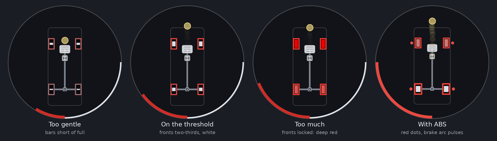

**The skill:** braking as hard as the tyres allow, right at the point where any more would lock them. A rolling tyre near its peak brakes harder than a sliding one, so the fastest stop is just short of a lock-up, not in one.

**What to look for:**
- **Too gentle:** the front bars short, the G-force dot short of where it could be. You're braking later than you could.
- **On the threshold:** the front bars well up and white, the outlines bright red, and the G-force dot as far forward as it gets (around 1 g for a road car, much more with downforce). In the second picture the front bars are only about two-thirds full: the tyres are already making over 90 % of their grip there (see [The grip bar](#grip-bar)). In a braking zone the last third comes in a rush: a wheel that goes past its peak under braking can't hold there, and locks.
- **Too much:** a front tyre turns pink, then deep red: locked. A locked tyre brakes less than one at the threshold, and a locked front tyre can't steer: you can see the steering arc grow while the car carries straight on.
- **With ABS:** the brake arc pulses and red dots appear by the wheels ABS is holding. ABS is keeping them near the threshold for you.

**How to practise:**
1. At the end of a long straight, brake progressively and squeeze until the fronts are just short of pink.
2. Hold the pedal there. If one goes pink, ease off a touch until it's white again.
3. Brake hard at first, then ease the pedal as you slow. With downforce, the grip falls with speed, so a pedal that was at the threshold at 250 km/h locks at 120.
4. Try it with ABS off and compare: if your braking distance matches ABS's, with pale pink at most, you've got it.

**Common mistakes:**
- **Stabbing the pedal.** The fronts jump straight to deep red. Squeeze instead: the load has to move onto the front tyres before they can take full braking (the G-force dot moving forward is that load arriving).
- **Locking the rear first.** A rear tyre turning red under braking means too much rear brake bias, or braking while turning on a light rear. A car with locked rears wants to spin.
- **Braking over a kerb or a crest:** a wheel that goes light locks at once (pale blue, then deep red). Ease off over the bump.
- **Downshifting too early.** In a rear-drive car, engine braking adds to the rear brakes: the rear outlines go bright red and the rears lock. Watch them as you blip down.

## Trail braking, and reading the G trail

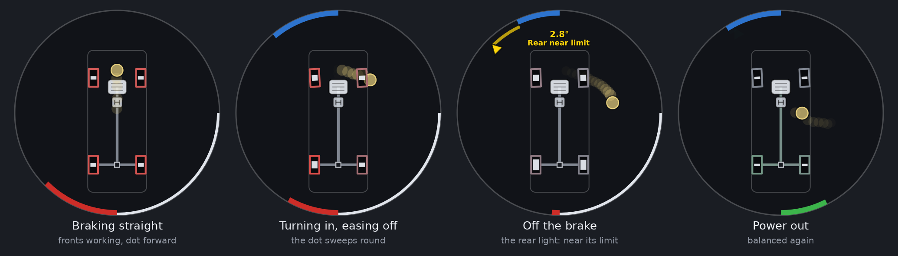

**The skill:** carrying some braking into the corner and easing it off as you add steering, so the tyres hand their grip from braking to cornering without a gap. It also keeps load on the front tyres as you turn in, which helps the car turn.

**What to look for:**
- The **front bars stay up** from the braking zone through turn-in, while the job changes from braking to cornering (the outlines fade from red back to grey as you release the brake).
- The **G-force dot sweeps round** near the edge of the circle, from forward (braking) through forward-and-sideways to sideways (cornering), and then on round the back as you power out. Its trail draws an arc.
- A yellow *Front near limit* during turn-in is normal: you're using the front tyres fully. Orange-red *Understeer* means you've asked for too much: too much brake left on for the steering you've added.
- As the brake comes off, the rear is light: in the third picture the rear is near its limit for a moment. That's the car rotating, which is what trail braking is for. Too much, and it steps out.

**Reading the G trail:**
- **Smooth:** the trail curves round the edge of the circle. You used all the grip, all the time.
- **Brake, coast, turn:** the trail drops back towards the middle between braking and cornering. For that moment the tyres had grip to spare and you didn't use it.
- **All at once:** full brake and full steering together. The fronts go past their peak (pink or red), the car understeers, and the trail cuts inside the edge: less total force, not more.

**How to practise:**
1. Pick a slow corner after a straight. Brake in a straight line at the threshold.
2. As you start to turn, ease off the brake progressively, about as fast as you add steering. Aim to be off the brake about when you reach the apex.
3. Watch the trail: aim for a smooth curve, close to the edge, with no dip towards the middle.
4. If the fronts go pink as you turn in, you're releasing the brake too slowly or steering too fast; if the trail dips to the middle, you're releasing too early.

**In a rear-drive or mid-engined car**, trail braking lightens the rear as you turn in, which helps the car rotate. Too much, and the rear gets light enough to slide: *Rear near limit*, then *Oversteer*. That's the same idea as [lift-off oversteer](#lift-off-oversteer).

## Throttle or brake mid-corner: why the line widens or tightens

Mid-corner, the tyres are already using most of their grip to turn. Adding brake or throttle asks some of them to do a second job too, and whichever axle runs out first decides what the car does:

- **If the front tyres run out, the car understeers: the line widens.** You run wide however much you steer.
- **If the rear tyres run out, the car oversteers: the line tightens.** The car rotates into the corner, and then may spin.

Which axle runs out depends on the car and on what you add:

| What you add mid-corner | Front drive | Rear drive | All-wheel drive | Mid or rear engine |
|---|---|---|---|---|
| **Throttle, a little** | Load moves back off the front: slight understeer | Load moves onto the rear: usually steadies the car | Usually steadies the car | Load onto an already loaded rear: steadies the car |
| **Throttle, a lot** | The fronts must steer *and* pull: they run out, often the inside one spinning. **Understeer** | The rears must corner *and* drive: they let go. **Power oversteer** | Depends on the torque split: rear-biased cars oversteer, front-biased ones understeer, a powerslide in between | Power oversteer, often sudden |
| **Brake** | The fronts take most of the braking on top of the cornering: **understeer** | Usually understeer as well. A light rear, or rear-biased brakes, can make it rotate instead | Usually understeer | The rear goes light while still carrying a lot of cornering: **oversteer** |
| **Lift off the throttle** | Load moves forward: the car tucks in, the line tightens slightly | The line tightens; with a light rear, it can step out | The line tightens slightly | **Lift-off oversteer**: the line tightens, sometimes sharply |

**What to look for:** watch both axles' bars as you add the pedal, and note which fills first. The marker tells you the result: yellow first (*Front near limit* or *Rear near limit*), then orange-red or pink-magenta. The G-force dot moving forward or back shows the load shifting.

**What to do with it:**
- **Running wide on the power in a front-drive car?** Less throttle until the fronts are white again; the car will turn. Then add throttle as you unwind the steering.
- **Rear stepping out on the power?** Ease the throttle and steer towards the marker (see [Power oversteer](#power-oversteer-catching-a-slide)).
- **Running wide under braking mid-corner?** Less brake, not more steering. The fronts can't do both.
- **Want the car to turn more?** A small lift, or a trail of brake, moves load onto the front and helps it turn, as long as the rear can take it. Watch for *Rear near limit*.
- The general rule: **the more you're steering, the less pedal you can use, and the other way round.** Unwind the steering as you add throttle out of a corner, and finish most of your braking before you add steering going in.

## Finding the limit in a steady corner

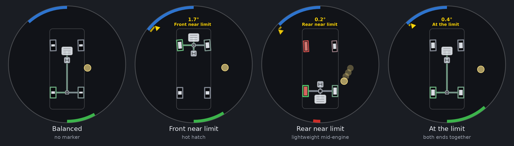

**The skill:** knowing how fast you can take a corner, and which end of the car will give up first.

**What to look for:** take a long, steady corner a little faster each lap.
- **No marker:** neither end near its limit.
- **Yellow, *Front near limit*:** the front tyres are at about 94 % of their grip or more, and will give up first. Most road cars are set up this way on purpose, because understeer is easier for most drivers to deal with (second picture: a front-drive hatchback).
- **Yellow, *Rear near limit*:** the rear will go first. Typical of mid- and rear-engined cars, and of rear-drive cars on the power (third picture: a light mid-engined car).
- **Yellow, *At the limit*:** both ends near their limit together. That's the fastest a car can corner: all four tyres working fully. Racing setups aim for it.
- **The degrees** at the top say how much more one end is slipping than the other.

**Why it matters:** the yellow is your margin. Once you see it, the car is close; one more step (a bump, more speed, a lift, a stab of throttle) tips it into understeer or oversteer. Fast, safe driving lives on the edge of the yellow, not past it.

**How to practise:** find the speed where yellow just comes on, and hold it there through the whole corner with small, smooth inputs. Then try the same with a little more and a little less throttle, and watch which end the warning moves to.

## Curing understeer

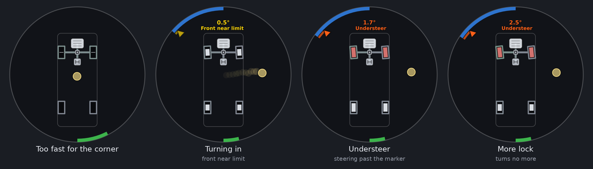

**What it is:** the front tyres past their peak, so more steering gives no more turning, only more scrubbing. The car runs wide.

**What to look for:** the steering arc running past the marker, with an orange-red band between them, *Understeer* at the top, and the front tyres pink. The G-force dot doesn't move further out as you add steering. In the last picture the steering has grown and the car turns no more: the marker and the dot haven't moved.

**What to do:**
1. **Unwind the steering towards the marker.** This is the counter-intuitive part: the front tyres grip again once their slip comes back down to their peak, and the car turns *more* with less lock. The band shrinks, the fronts go white, and the G-force dot moves out again.
2. **Ease off the throttle** (or the brake), smoothly, so the front tyres have more of their grip for turning. Lifting sharply in a car with a light rear can swap understeer for oversteer.
3. **Next time, brake earlier** or turn in more gently.

**Common mistakes:**
- **Adding more lock.** The most common mistake there is, and the one this display shows most clearly.
- **Turning in too fast.** A sudden steering input asks for full grip before the load has moved onto the outside front tyre. Turn in progressively, and *Front near limit* comes on gently instead of jumping to *Understeer*.
- **In a front-drive car, too much throttle mid-corner.** See [above](#throttle-or-brake-mid-corner-why-the-line-widens-or-tightens).

## Power oversteer: catching a slide

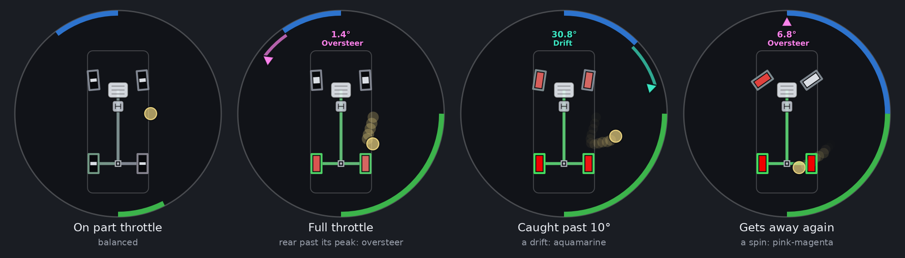

**What it is:** in a rear-drive car, the rear tyres asked to corner and drive at once, and letting go.

**What to look for:** the rear bars filling (green outlines: they're driving), then pink and red. The marker jumps out beyond the steering in pink-magenta, and *Oversteer* shows how many degrees more the rear is slipping than the front. Past 10° of slide it turns aquamarine, *Drift*, with the angle. The G-force dot often swings back towards the middle, because a sliding rear gives less force.

**What to do:**
1. **Steer towards the marker.** It sits where the front of the car is travelling: steering at it points the front wheels where they're going, so they grip and pull the nose straight. Follow it as it moves.
2. **Ease the throttle, don't lift.** Lifting sharply moves the load forward off the rear, and can make the slide worse or snap the car back the other way. Bring it down until the rears are pink rather than red.
3. **As it comes back**, unwind the steering and the throttle together as the car straightens.

**What going wrong looks like:**
- **Too slow on the steering, or too much throttle for too long:** the marker races off past full lock and the steering arc can't reach it. That's a spin (last picture): brake and hold the steering straight (or press the clutch) until it stops.
- **Too much countersteer, held too long:** as the rear grips again, the marker swings back past centre while the steering is still on opposite lock. The car snaps the other way (a "tank-slapper"). Unwind as the marker comes back: always follow it, don't lead it.

## Lift-off oversteer

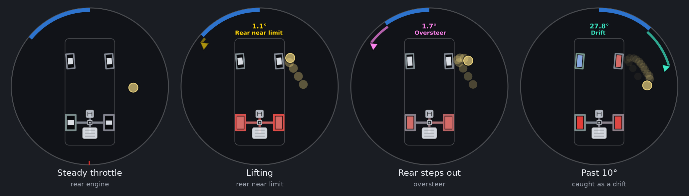

**What it is:** lifting off the throttle (or braking) mid-corner moves load forward. The rear tyres lose load, and so grip, while they're still carrying the corner. In a mid- or rear-engined car, or one already near its rear limit, the rear steps out.

**What to look for:** the G-force dot jumps forward as you lift, the rear outlines turn red (engine braking), the rear bars go pink, *Rear near limit* (yellow), and then the marker swings out: *Oversteer*, then, past 10°, *Drift*.

**What to do:** a small, quick correction towards the marker, and gentle throttle back on to put load back on the rear. Don't lift further or brake.

**How to avoid it:** when you see *Rear near limit*, keep the throttle steady. If you need to slow down, unwind a little steering first, then lift gently.

**Using it on purpose:** a deliberate small lift on turn-in helps a car that understeers to rotate. Done right, the marker goes from *Front near limit* to nothing, or briefly to *Rear near limit*, and the car turns in.

## Drifting

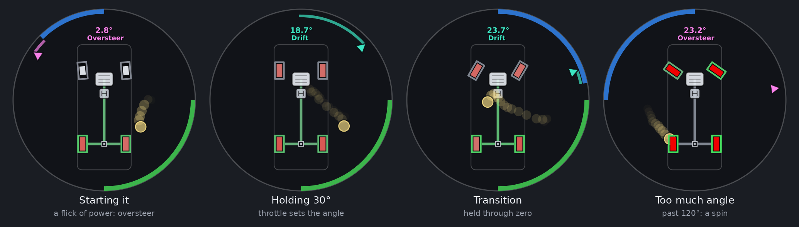

**The skill:** a held slide, the rear sliding at a big angle, the front pointing where the car is going, kept steady with throttle and steering.

**What to look for:**
1. **Starting it** (a flick of power, the handbrake, a clutch kick, or a feint): the rear goes pink and red, the marker swings out in pink-magenta, *Oversteer*.
2. **Holding it:** past 10° it's aquamarine, ***Drift***, with the drift angle on top: how far the rear is sliding, as Drift Scoring shows it. Keep the steering on the marker, so the front wheels point where the front is going.
3. **A transition:** flicking the car from one direction to the other, the angle passes through zero. The drift is held through it for half a second, so the colour stays aquamarine.
4. **Too much angle:** past 120° it's a spin, and pink-magenta again.

**How to hold an angle:** the throttle sets the angle (more throttle, more rear wheelspin, more angle), the steering keeps the front pointing where the car is going (on the marker). To hold 35°, keep the steering on the marker and adjust the throttle until the degrees at the top stay put.

**Practising:** a big circle on a smooth surface (AC's drift track is made for it). Start the slide, catch it, and try to keep the marker aquamarine for a full lap. Then try to hold a chosen angle, say 30°, within a few degrees. A car with a locked or welded diff is easier: both rears spin together. Drift Scoring, run alongside, scores the same angle.

## All-wheel-drive powerslides

**What it is:** the rally way of sliding an all-wheel-drive car, best on a loose surface. All four tyres slide under power, the rear more than the front, and you steer *into* the corner: the driven front tyres pull the car round, rather than you catching the rear with opposite lock.

**What to look for:** all four tyres pink, the outlines green, the rear sliding more than the front, the steering into the turn, the throttle on. Once it holds, the marker and the top turn aquamarine: ***Powerslide***, with how far the rear is sliding. Past 10° of rear slide it reads *Drift* instead.

**What going wrong looks like:**
- **Ploughing:** the fronts sliding far more than the rears, the car running wide. That's *Understeer*, not a powerslide. Less steering, and a lift to move load forward, or a dab of brake (left-foot braking) to rotate it.
- **Rear getting away:** the slide growing quickly turns it pink-magenta (*Oversteer*). Catch it with the steering like a rear-drive car.

## Launches and race starts

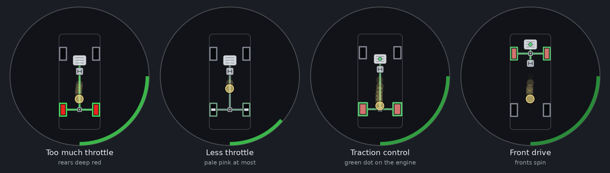

**The skill:** the quickest getaway: the drive wheels at their peak, about 10–15 % slip.

**What to look for:**
- **Too much throttle:** the drive wheels deep red. They're spinning far past their peak, so they push less. The G-force dot hardly moves back.
- **Just right:** the drive wheels' bars well up, at most a pale pink flicker. The G-force dot as far back as it goes.
- **Traction control:** a green dot on the engine and a pulsing throttle arc. It's cutting power for you. If you see it all through a launch, you're asking for more than the tyres can take; less throttle may be just as quick and smoother.
- **Front drive:** accelerating moves load back, off the driven front tyres. Front-drive cars spin their wheels sooner, and the pink comes earlier.

**How to practise:** launch with full throttle and note the colour, then try again with less, until the drive tyres are no more than pale pink. Watch the G-force dot: the launch that pushes it furthest back is the quickest. In a manual car, the clutch arc shows how fast you're letting it out. For race starts, rehearse it from the grid in a practice session; on a rolling start, the same applies out of the last corner.

**Out of a slow corner** it's the same, plus steering: the inside drive wheel carries the least load and spins first (see [Differentials](#differentials)).

## Kerbs, crests and track limits

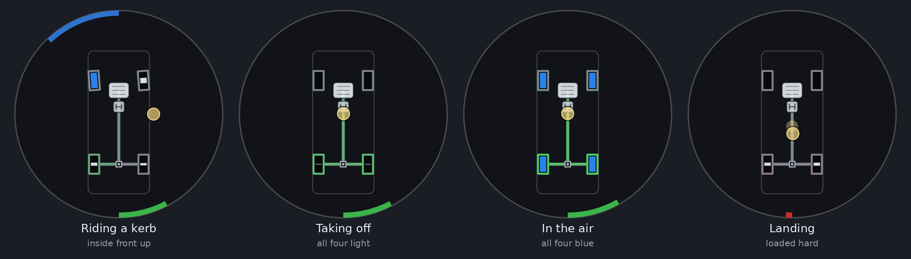

**The point:** a tyre with no load has no grip. It can't steer, brake or drive.

**What to look for:**
- **A kerb** lifts a wheel: blue. That corner of the car isn't doing anything, so the others carry the whole corner. A tall sausage kerb can lift two.
- **A crest** lightens all four: pale blue. Steering or braking over a crest asks for grip that isn't there: a lift-off slide or a lock-up waiting to happen.
- **In the air**, all four are blue. A drive wheel still under power spins up (green outline); when it lands spinning it kicks the car sideways.
- **Landing** loads every tyre heavily for a moment.

**What to do:** use the kerbs that keep the wheels white and pale blue at most; the ones that turn a wheel blue are costing you grip. Brake before a crest, not on it. Over a jump or a sharp crest, land with the wheels straight and the throttle steady or lifted, so the drive wheels aren't spinning when they touch. Don't use the inside kerb if the inside wheels are already pale blue.

## Grip that changes: wet, cold, worn and dirty

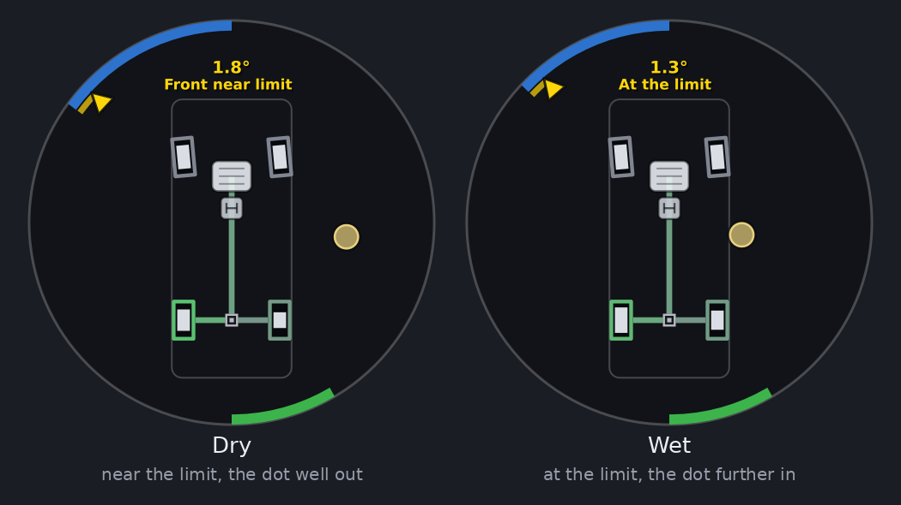

**The point:** the grip bars show how far along its grip curve each tyre is; the G-force dot shows how *much* grip there is. On every surface a full bar means "at the peak", but the peak comes at very different forces.

This is where AC's tyre model helps most. The grip level changes with the surface, the rain, the tyre's temperature and its wear, but `ndSlip` is measured against the tyre's own peak. So the bars and the balance mean the same thing in the wet, on cold tyres or on worn ones, with nothing to relearn, and the G-force dot shows what's left.

**What to look for:**
- **On a wet track**, the limit comes with the dot well short of where it reached in the dry, and the warnings come at lower speeds. In the pictures: the same corner dry, with the front near its limit and the dot well out, and wet, with both ends at the limit and the dot further in.
- **On cold tyres** out of the pits, the dot gets less far for the same bars. As they warm up, it reaches further.
- **Over a stint**, as the tyres wear, the dot at the limit creeps in, and the end that wears faster starts to show its warning first: a front-limited car gets more *Front near limit*.
- **Off line**, on the marbles or a dirty part of the track, a tyre that strays goes pink with the dot suddenly smaller.

**How to use it:** on a new surface, or the first lap of a stint, find the limit gently: brake in a straight line until the fronts are just short of pink, and note how far out the G-force dot gets. That's how hard you can brake or corner there.

## Differentials

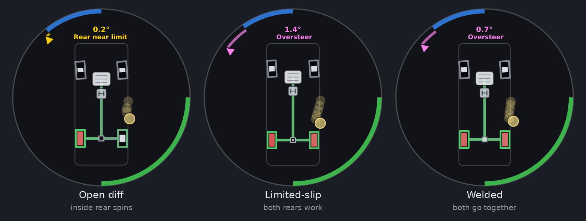

The differential decides how the drive is shared between the left and right wheels. The display draws its type (hollow: open; centre block: limited-slip; solid: locked) and shows each wheel's grip, so you can see what it does.

- **Open diff:** both wheels get the same torque, and that's limited by the wheel with less grip. Out of a tight corner, the light inside wheel spins pink or red while the outside one has grip to spare (first picture). Ease the throttle until the inside one is white again.
- **Limited-slip diff:** it sends more torque to the wheel with more grip. Both bars work, and you get more drive out of the corner. Too much power still overwhelms both, and on a rear-drive car, both rears letting go together is a quicker slide (second picture). In AC's setup screen, the diff's power lock decides how much it locks on the throttle, its coast lock off the throttle, and its preload how much it locks all the time.
- **Locked or welded diff:** both wheels turn at the same speed whatever. Excellent traction and easy drifting, but in a corner the inside wheel is dragged round faster than it wants to go, which pushes the car straight on. Watch for *Front near limit* or *Understeer* on turn-in, and a sudden step out when both rears let go together.
- **All-wheel drive:** watch the centre diff and the shafts, and which axle's bars fill first on the power.

The drawn diff type comes from the car's files, not your setup: changing the lock in the setup changes what the wheels do, but not the drawing.

## Downforce: fast corners and slow ones

Race cars with wings and diffusers grip by load, and downforce adds load as the square of the speed. So the same car can be a different car in a slow corner and a fast one, and the display shows it:

- **The G-force dot goes past the edge.** At 1.5 g the dot is pinned to the rim. A GT3 car reaches that in fast corners and under braking from high speed; a prototype or a single-seater goes well past it. The bars and the balance are still right. To see the whole range, raise `GF_MAX` in `src/render.lua` (to 3 for a prototype, say).
- **The balance moves with speed.** The aero balance (how the downforce splits between front and rear) and the mechanical balance differ, so a car can show *Front near limit* in the hairpin and *Rear near limit* in the fast sweeper, or the other way round. Which yellow comes first at which speed is exactly what wing and ride-height changes adjust.
- **Braking from top speed**, the grip falls as you slow: the fronts that were white at 250 km/h go pink at 120 if the pedal stays where it was. Ease the pedal as you slow.
- **A crest or a bump at speed** unloads the car aerodynamically as well as mechanically: pale blue on all four is the sign.

## A lap, corner by corner

Every corner has the same phases, and each has its own look on the display. At a track you know, take one corner and check each phase in turn:

| Phase | What good looks like | What going wrong looks like |
|---|---|---|
| **Braking zone** | Fronts well up and white, the dot far forward, the rears a little lower | A front pink or red (lock-up); a rear red (too much rear bias, or downshifting too early in a rear-drive car) |
| **Turn-in** | The dot sweeping round the edge as the brake comes off; *Front near limit* at most | *Understeer* (too much brake still on, or turning in too fast); *Rear near limit* then *Oversteer* (too much brake on a light rear) |
| **Apex** | The dot at its furthest out sideways; *At the limit* or one end's yellow | The dot dropping towards the middle (coasting: grip unused) |
| **Exit** | The throttle growing as the steering unwinds, drive outlines green, the drive tyres white | The inside drive wheel pink or red (wheelspin), *Understeer* in a front-drive car, *Oversteer* in a rear-drive one |
| **Kerbs** | Wheels white or pale blue | A wheel blue, then red as it lands spinning |

In a replay, the same corner lap after lap shows which phase changed when your time did.

## Learning from ABS and traction control

| You see | The assist is | It means you |
|---|---|---|
| Red dots, brake arc pulsing | ABS, holding wheels near their peak | Braked harder than the tyres can take. Fine in an emergency; for practice, find the threshold just below it |
| Green dot on the engine, throttle arc pulsing darker | Traction control cutting power | Asked for more drive than the tyres can take |

AC lets you set ABS and traction control on, off, or to the car's own levels (and on many cars change the level from the cockpit). A good exercise: drive a lap with the assists on and count the dots. Then try to drive the same lap with none showing at all, and you've learnt to stay just inside the limit. On cars with adjustable levels, the lowest traction-control setting that gives no dots on a clean exit is usually the quickest.

## Setting up a car with it

The display shows what a setup change actually does to the tyres. Drive the same corner the same way before and after a change, and compare.

**First, find where the problem is.** Most handling complaints happen in one phase of a corner, and the display tells you which:

| Phase | What to watch |
|---|---|
| **Braking in a straight line** | Which axle's tyres go pink first. Rears first: brake bias too far back |
| **Turn-in, on the brakes** | *Front near limit* or *Understeer* (entry understeer), or *Rear near limit* or *Oversteer* (entry oversteer) |
| **Mid-corner, steady** | Which yellow comes first. *At the limit* is ideal |
| **Exit, on the power** | Front-drive: the inside front spinning, *Understeer*. Rear-drive: the inside rear spinning (open diff), or both rears going, *Oversteer* |
| **Lifting mid-corner** | *Oversteer* right after the dot jumps forward |
| **Slow corners against fast ones** | Whether the same yellow comes first at both speeds: if not, the aero balance and the mechanical balance differ |

**Then the usual first things to try** in AC's setup screen (general setup principles: every car differs, so change one thing at a time and check the result on the display):

| Symptom | Usual first changes |
|---|---|
| Understeer mid-corner | Softer front anti-roll bar, or stiffer rear; more negative front camber; more front wing or less rear |
| Oversteer mid-corner | The reverse: stiffer front anti-roll bar, or softer rear; more rear wing |
| Understeer in fast corners only | More front wing, or less rear; lower front ride height (rake) |
| Oversteer in fast corners only | More rear wing, or less front |
| Understeer on entry, braking | Brake bias a little rearwards; softer front |
| Oversteer on entry, braking | Brake bias forwards; more diff coast lock (rear drive) |
| Power oversteer on exit | Softer rear anti-roll bar or springs; less diff power lock; smoother throttle |
| Inside wheel spinning on exit | More diff power lock or preload |
| Power understeer on exit (front drive) | Less front diff lock, or a softer front; or less throttle until the wheel is straighter |
| Lift-off oversteer | More diff coast lock; softer rear; a gentler lift |
| A wheel lifting over kerbs | Softer springs or dampers at that end, or a higher ride height |

Things to check while you do it:

- **Is the brake bias right?** Brake hard in a straight line: the fronts should reach the threshold a little before the rears.
- **Are the tyre pressures and temperatures right?** A tyre outside its window grips less: the dot reaches less far for the same bars.
- **Did the diff change help?** Watch the inside drive wheel out of the slowest corner: white, or pale pink at most, is the aim.

## Replays, spectating and the AI

The app shows the car the camera is on, so it isn't only for your own driving:

- **Replays.** Watch any part of a session back with the app open: it follows the replay's car, tyre by tyre. Slow the replay down to see the order of events in a moment that went wrong: which tyre went first, whether a wheel was locked, whether the inside wheels were already light. Pause it, and the readings hold that moment.
- **Your fastest lap against a slower one.** In the replay, watch the same corner on both. The faster lap usually has the dot further out for longer, and fewer pink tyres.
- **The AI.** Switch the camera to an AI car and watch how it brakes, where it gets on the power, and how close to the limit it drives.
- **Online.** Spectating, or in the replay afterwards, you can watch another driver's car the same way: where they brake, how they use the kerbs, how they balance the car.
- **Streaming and coaching.** Viewers, or a student, can see exactly what the tyres were doing and why the car did what it did.

## Common mistakes, and how they look

| You see | What happened | What to do instead |
|---|---|---|
| Fronts deep red under braking | A lock-up | Ease the brake until they're white or pale pink |
| Steering arc far past an orange-red marker | Understeer: you added lock the fronts can't use | Unwind to the marker, ease off the pedal |
| G-force trail drops to the middle between braking and turning | A gap: grip unused | Release the brake as you add steering (trail braking) |
| Fronts pink and *Understeer* as you turn in on the brakes | Too much brake still on for the steering | Release the brake sooner, or turn in more gently |
| Inside drive wheel red out of a slow corner | Wheelspin: open diff, too much throttle | Less throttle until it's white, more as you unwind the steering |
| Rears red, marker swinging out, out of a corner | Power oversteer | Ease the throttle, steer to the marker |
| *Rear near limit*, then *Oversteer* the moment you lift | Lift-off oversteer | Keep the throttle steady when the rear is near its limit |
| Marker swinging back past centre while you're on opposite lock | The rear has gripped again | Unwind as it comes back; follow it, don't lead |
| Rears bright red outlines and deep red tyres on a downshift | Engine braking locking the rears | Downshift later, blip, or ease the clutch out |
| Drive wheels deep red off the line | Too much launch throttle | Less, until they're pale pink at most |
| A wheel turning blue on a kerb, then red as it lands | Too much kerb, or on the power over it | Use less of that kerb, or straighten before it |
| ABS or traction-control dots all the time | Driving on the assists | Find the limit just below them |

---

# How it measures

This part is for the curious, and for anyone tuning the settings. Nothing here is needed to use the display.

The app is three Lua files:

| File | What it does |
|---|---|
| `VGSDisplay.lua` | The app window and its settings. Every frame it picks the car the camera is on, passes it to the telemetry, and has the renderer draw the result. Anything that fails is caught, logged at most every 10 s, and shown in the settings window; the app carries on |
| `src/telemetry.lua` | The measurements: the layout (captured once per car), each wheel's grip, slide, torque, steering and assists, the inputs, the G-force, the direction of travel, the balance, the drift and the powerslide. It returns the same "body" shape the BeamNG version's vehicle script sends |
| `src/render.lua` | The drawing: a straight port of the BeamNG version's `app.js`, drawing with CSP's UI calls |
| `src/carinfo.lua` | The table of car makers and models, tags and description rules that place the engine |

## What it reads from AC

Every frame, from CSP's `ac.getCar()` for the focused car:

| Value | Used for |
|---|---|
| Each wheel's `ndSlip` | The grip bar, past the limit, each axle's nearness to its limit |
| Each wheel's `slipRatio`, `slipAngle` | The slide colour, the torque outline, the drift angle, ABS dots |
| Each wheel's `load` | Wheels light or off the ground; weighting each axle's `ndSlip` |
| Each wheel's `position`, `look`, `tyreRadius`, `tyreWidth`, `isBlown` | Where it's drawn, its steering angle, its size, a blown tyre |
| The car's `velocity`, `look`, `up`, `position`, `localAngularVelocity` | The G-force, the direction of travel, the yaw rate, teleports |
| `gas`, `brake`, `clutch`, `handbrake`, `steer`, `steerLock`, `gear` | The rim arcs, the steering scale, reverse |
| `absInAction`, `tractionControlInAction` | The assist dots and pulses |
| `tractionType`, `aabbSize`, `aabbCenter` | The drive layout, the outline |

And once per car, from its data files (unpacked or in `data.acd`): `drivetrain.ini` (the layout and the differentials), `suspensions.ini` (`CG_LOCATION`, the weight distribution), `car.ini` (`STEER_LOCK`, `STEER_RATIO`), and `ui_car.json` (tags, name, brand, description), with CSP's car ID, name and brand.

The optional values are looked up defensively: a field that's missing in a CSP version only switches that part off.

## The grip bar and the slide colour

- **The bar** is the tyre's `ndSlip`, smoothed lightly (half the gap closed every 1/30 s, `GRIP_SMOOTHING`, set per time so the frame rate doesn't change how it feels). `ndSlip` can run far past 1 in wheelspin; the bar stops at full.
- **Past the limit** from `ndSlip` 1.0 (`SLIDE_ON`), back under it below 0.85 (`SLIDE_OFF`).
- **The slide colour** comes from the tyre's combined slip: `√(slip ratio² + tan² slip angle)`. Pink up to 30 % (`SLIP_RATIO_PINK`), deepening to full red at 100 % (`SLIP_RATIO_FULL`); `PINK_SEVERITY` sets how far towards red the colour has moved by the end of the pink band. Below 5 m/s (`RATIO_MIN_SPEED`) the slip is scaled down in proportion to the speed.

## The torque outline

AC doesn't report the torque on each wheel, but it does report each tyre's slip ratio: how much faster or slower it turns than the road. That's what the tyre is being asked to transmit, so the outline comes from it:

1. **Each axle's peak slip ratio is learnt.** While a tyre runs nearly straight (slip angle under 1°) and is part-way up its curve (`ndSlip` between 0.25 and 1.2), its slip ratio over its `ndSlip` is the slip ratio where it would peak. Each axle's is averaged over about a second (`SR_PEAK_TAU`), starting from 12 % (`SR_PEAK`). It's learnt in the first few moments of accelerating or braking.
2. **The share of grip.** The tyre's slip ratio against that peak, read through a usual tyre's grip curve (a Magic Formula shape, `TYRE_SHAPE_C` 1.45: the curve in [the grip bar's picture](#grip-bar)), gives the share of the tyre's grip in use; the longitudinal part of it is the outline. So braking at a third of the peak slip ratio shows about three quarters red, and full is the tyre at or past its peak.
3. **At a standstill** (under 0.5 m/s) the outline follows the brake pedal, and the handbrake on the rears, so a held brake shows.

The shafts show the driven wheels' torque: drive while you're on the throttle (over 2 %), engine braking while you're off the throttle and the brakes.

In the simulation the outline's error fell from 0.12 to 0.05 (share of grip) with this method, against the fixed 12 % of 2.5-ac2.

## Wheels off the ground

- **Off the ground:** under 150 N (`MIN_LOAD`) for 0.25 s (`AIR_SHOW_AFTER`); back on above 300 N. Until it's shown off the ground, the grip bar and slide colour hold.
- **Nearly off:** below a quarter (`LIGHT_FRAC`) of the wheel's normal load, smoothed at 2 Hz (`LIGHT_HZ`). The normal load is followed over about 2 s (`LIGHT_REF_TAU`) while the wheel carries more than half of it.

## Steering angles and the direction of travel

- **Each wheel's steering angle** is the wheel's heading (`look`) against the car's, minus its straight-ahead. Straight ahead is captured while the steering input is centred (under 0.4 %, `CENTRE_INPUT`) and refined whenever you're really driving straight (`CENTRE_TAU`). Opened mid-corner, before the wheels have been seen straight, it takes the car's own heading (the nearest quarter turn), so the steering is right to within half a degree from the first frame.
- **Full lock** at the road wheels is the steering wheel's lock over the rack's ratio, from `car.ini`. If that's missing, it's learnt from how far the front wheels turn for a given input.
- **Each axle's direction** comes from the car's velocity plus its yaw rate times the distance to the axle. AC's chassis is rigid, so that's exact.
- **The marker,** while the rear grips, is the turn the yaw rate gives (wheelbase × yaw rate / forward speed) plus any rear steering, against the rear axle's path; once the rear slides (its slip between 8° and 20°, `REAR_GRIP_SLIP`, `REAR_SLIDE_SLIP`), it eases over to the front axle's direction against the body. It's converted to the steering's units with the ratio the front wheels actually show right now (a running least-squares slope of wheel angle against input over the last second, `RATIO_TAU`), so the marker meets the arc whenever the front and rear slip equally.
- **The marker's smoothing** is the BeamNG version's adaptive ("One Euro") filter, on where it's drawn (degrees round the rim): strong while it holds still (`MARK_MIN_CUTOFF`), opening up as it moves (`MARK_BETA`) or as you steer (`MARK_STEER_GAIN`), and almost at once for big, fast swings (`MARK_FAST_FROM`, `MARK_BETA2`). It fades out once the rear slides. The yaw rate it uses is lightly smoothed (`MARK_YAW_HZ`).
- **Spins:** the marker is kept continuous past 180°, so in a spin it stays on the side it started.

## How near each end is to its limit

Each axle's `ndSlip` is its tyres', weighted by their load, smoothed at 6 Hz (`GRIP_HZ`), and faded out below 7 m/s (`GRIP_MIN_SPEED` plus 3 m/s). The slip angle of each axle is where its wheels point against where it's going. The rules are in [The balance](#the-balance), with these settings:

| Rule | Setting |
|---|---|
| Near the limit from, and clear below | `NEAR_ON` 0.60, `NEAR_OFF` 0.50 |
| One end's warning rather than *At the limit* | `LEAD` 0.15 |
| A warning must last | `WARN_HOLD` 0.12 s |
| Past the peak from, and back under below | `PAST_ON` 1.0, `PAST_OFF` 0.92 |
| Understeer: the front further past its peak than the rear by | `US_LEAD` 0.10 (over below `US_LEAD_OFF` 0.06) |
| Oversteer: the rear slipping at a bigger angle than the front by | `OS_EXCESS` 0.035 rad, 2° (over below `OS_EXCESS_OFF` 0.02) |
| Turning needed: warnings and understeer, oversteer | `TURN_MIN_YAW` 0.05 rad/s (0.035 to hold), `OS_MIN_YAW` 0.10 (0.08 to hold) |

The order is: a drift first, then a powerslide, then a spin (past 120° above 20 km/h), oversteer, understeer, and the warnings.

## The G-force measurement

1. **The slope.** The acceleration is the least-squares slope of the car's velocity over the last 0.05 s (`GF_WINDOW`), or two and a half frames if that's longer, so a low frame rate still has enough samples. A slope averages out the body's vibration on its springs far better than the difference between two frames.
2. **Two smoothing stages** follow, at a cutoff that's low while the force holds steady (`GF_MIN_CUTOFF` 1.2 Hz), so the dot sits still, and opens up for changes faster than vibration (`GF_BETA`, `GF_D_FLOOR`): a turn-in, a stab of the brakes.

In the simulation, with about 0.05 g of body vibration, the dot was within 0.066 g of the true force and about 80 ms behind it. The BeamNG version's 1.20 takes the sideways part from speed × yaw rate instead, for about 35 ms; that isn't ported yet.

## Signs, starts and hiccups

- **Signs are learnt.** Which way the steering input points (from the front wheels' own angle), the yaw rate's sign (from the change in the car's heading) and the slip ratio's sign (from braking and driving) are each checked against the car's own motion, within the first moments of driving. So nothing depends on a convention the code had to assume. The diagnostics show what was learnt.
- **A pause** freezes the readings on that moment.
- **A teleport** (back to the pits, a restart, a jump of more than 10 m in a frame) clears the G-force history and the marker, so there's no spike or sweep.
- **A hitch** (a frame longer than a quarter of a second) restarts the filters.
- **A new car** (switching the camera, or a new session) captures its layout afresh.

## The engine position

AC doesn't record where a car's engine sits. Front-wheel-drive cars get a transverse engine at the front. For the others the app looks, in order, at:

1. **the car's tags** (`ui_car.json`), if they say "mid-engine", "rear-engine", "MR", "RR" or the like;
2. **its maker and model** (folder name, display name and brand), against a table of the models that aren't front-engined (the Kunos ones among them, with the Porsche 911 GT1 and the 2017 RSR as the mid-engined 911s they are) and of front-engined ones with their weight far enough back to fool the weight rule (the Ferrari F12 and 812, the Mercedes SLS and AMG GT, and so on);
3. **its description**, if it names one position only;
4. **the weight distribution** (`CG_LOCATION` in `suspensions.ini`): a front engine from 47 % of the weight on the front, a mid engine from 40 % to 47 %, and a rear engine below 40 %.

The weight alone can't tell a mid-engined Lotus (38 % on the front) from a rear-engined Porsche 911 (39 %), or a front-engined Ferrari F12 (46 %) from a mid-engined Cayman (45 %). On 248 real cars (most of the Kunos cars and many others, with their weight distributions approximated; 56 of them checked only after the table was written), the weight alone placed 90 % right and the four steps together all of them. The diagnostics say which step placed it. If it's still wrong for a car, pick the position in the settings, or add the car to `src/carinfo.lua`.

---

# Reference

## Settings you can change

**In the settings window** (the cog on the app's title bar):

| Setting | Default | What it does |
|---|---|---|
| Show the drivetrain | on | Draw the engine, gearbox, diffs and shafts under the wheels |
| Background | 62 % | How solid the circle is: 0 % fully see-through, 100 % solid |
| Engine position | Automatic | Front, mid (ahead of the rear axle), rear (behind it) or transverse at the front, for when the automatic placing guesses wrong |

These are kept between sessions.

**In the code.** The rest are constants at the top of `src/telemetry.lua` (the `TUNE` table) and `src/render.lua`. Most keep their BeamNG names and meanings. The defaults were tuned against the simulated fleet (see [How it was tested](#how-it-was-tested)), so change them only with a reason. After editing, restart the session, or close the app and open it again (it's fully unloaded when closed).

### In `src/telemetry.lua`

**Grip bars, slides and torque**

| Setting | Default | What it does |
|---|---|---|
| `SLIDE_ON` / `SLIDE_OFF` | 1.0 / 0.85 | `ndSlip` above which a tyre counts as past its limit, and below which it grips again |
| `SLIP_RATIO_PINK` | 0.30 | Slip up to which a sliding tyre stays pink |
| `SLIP_RATIO_FULL` | 1.00 | Slip shown as the deepest red |
| `PINK_SEVERITY` | 0.2 | How far towards deep red the colour has moved by the end of the pink band |
| `RATIO_MIN_SPEED` | 5.0 m/s | Below this the slip is scaled down with the speed |
| `GRIP_SMOOTHING` | 0.5 | How quickly the grip bar and slide colour follow: the share of the gap closed every 1/30 s |
| `SR_PEAK` | 0.12 | Peak slip ratio assumed for the outline until each axle's own is learnt |
| `SR_PEAK_TAU` | 1.0 s | How fast it's learnt |
| `TYRE_SHAPE_C` | 1.45 | Shape of the grip curve the outline's share of grip is read through |
| `SR_ABS` | 0.04 | Braking slip ratio from which a wheel gets the ABS dot while ABS works |
| `STANDSTILL_SPEED` | 0.5 m/s | Below this the outline follows the brake pedal |

**Wheels off the ground**

| Setting | Default | What it does |
|---|---|---|
| `MIN_LOAD` | 150 N | Below this a wheel has no grip, and counts as off the ground once it stays that way ... |
| `AIR_SHOW_AFTER` | 0.25 s | ... for this long |
| `LIGHT_FRAC` | 0.25 | Below this share of its normal load a wheel starts to turn pale blue |
| `LIGHT_HZ` | 2 Hz | Smoothing of the load for that |
| `LIGHT_REF_TAU` | 2 s | How slowly a wheel's normal load is followed |

**G-force dot**

| Setting | Default | What it does |
|---|---|---|
| `GF_WINDOW` | 0.05 s | The stretch of velocity the slope is fitted across (at least two and a half frames) |
| `GF_MIN_CUTOFF` | 1.2 Hz | Smoothing while the force holds steady. Lower is stiller |
| `GF_BETA` | 3 | How much the smoothing opens up as the force changes quickly |
| `GF_D_FLOOR` | 2 g/s | Changes slower than this don't open it up |
| `GF_D_CUTOFF` | 0.5 Hz | Smoothing of the rate of change the filter reacts to |
| `GF_STAGES` | 2 | Smoothing stages |

**Steering scale and direction marker**

| Setting | Default | What it does |
|---|---|---|
| `STEER_EXPAND` | 20 | Least stretch of the steering scale, at low speed. 0 for none |
| `STEER_TARGET` | 0.6 | Share of the quarter turn that a 1 g corner's steering fills at any speed |
| `STEER_K_MAX` | 400 | Most stretch allowed |
| `TRAVEL_SMOOTH_HZ` | 40 | Smoothing of each axle's direction |
| `YAW_SMOOTH_HZ` | 30 | Smoothing of the yaw rate for the balance and the axle directions |
| `MARK_YAW_HZ` | 10 | Smoothing of the yaw rate the marker uses |
| `REAR_GRIP_SLIP` / `REAR_SLIDE_SLIP` | 0.14 / 0.35 rad | Rear slip (8° / 20°) between which the marker eases from the rear axle's path to the front axle's direction |
| `RATIO_TAU` | 1 s | History the steering input-to-wheel ratio uses |
| `CENTRE_TAU` | 3 s | How fast each wheel's straight-ahead settles while you drive straight |
| `CENTRE_INPUT` | 0.004 | Steering input below which the steering counts as centred |
| `LOCK_DEFAULT` | 0.6 rad | Front-wheel full lock until it's known |
| `TRAVEL_MAX` | 4 | Furthest the marker goes, in quarter turns |
| `TRAVEL_FADE_LO` / `TRAVEL_FADE_HI` | 0.5 / 1.5 m/s | The marker fades in between these speeds |
| `MARK_MIN_CUTOFF`, `MARK_BETA`, `MARK_D_CUTOFF`, `MARK_STEER_GAIN`, `MARK_STEER_CUTOFF`, `MARK_FAST_FROM`, `MARK_BETA2`, `MARK_D_FAST_CUTOFF` | 0.3, 0.005, 0.5, 0.06, 8, 180, 0.002, 2 | The marker's adaptive smoothing, as in the BeamNG version |

**The balance**

| Setting | Default | What it does |
|---|---|---|
| `NEAR_ON` / `NEAR_OFF` | 0.60 / 0.50 | An axle's `ndSlip` from which it's near its limit, and below which it's clear. Lower warns earlier |
| `LEAD` | 0.15 | How much nearer one end must be for its own warning, rather than *At the limit* |
| `WARN_HOLD` | 0.12 s | How long an axle must stay near its limit before the warning shows |
| `PAST_ON` / `PAST_OFF` | 1.0 / 0.92 | An axle's `ndSlip` from which it's past its peak, and below which it's back under it |
| `US_LEAD` / `US_LEAD_OFF` | 0.10 / 0.06 | Understeer: how much further past its peak the front must be than the rear, and below which it's over |
| `OS_EXCESS` / `OS_EXCESS_OFF` | 0.035 / 0.02 rad | Oversteer: how much bigger the rear tyres' slip angle must be than the front's, and below which it's over |
| `TURN_MIN_YAW` / `OS_MIN_YAW` | 0.05 / 0.10 rad/s | Yaw rate the car must be turning at for the warnings and understeer, and for oversteer |
| `GRIP_HZ` | 6 Hz | Smoothing of each axle's `ndSlip` |
| `GRIP_MIN_SPEED` | 4 m/s | Below this the limits aren't judged (fading in over the next 3 m/s) |

**Drift and powerslide**

| Setting | Default | What it does |
|---|---|---|
| `DRIFT_MIN_ANGLE` / `DRIFT_MAX_ANGLE` | 10 / 120 | Rear slip angle (degrees) from which it's a drift, and past which it's a spin |
| `DRIFT_MIN_SPEED` | 20 | km/h a drift must be faster than |
| `DRIFT_HOLD` | 0.5 s | How long a drift is held after the angle drops (through a transition) |
| `DRIFT_RATE_HZ` | 4 Hz | Smoothing of the slide's growth rate |
| `PS_REAR_START` / `PS_REAR_FULL` | 0.10 / 0.17 rad | Powerslide: rear slide (6° / 10°) where it starts to count, and fully |
| `PS_FRONT_START` / `PS_FRONT_FULL` | 0.035 / 0.07 rad | Powerslide: front slip into the turn (2° / 4°) where it starts to count, and fully |
| `PS_PLOUGH_START` / `PS_PLOUGH_FULL` | 0.09 / 0.17 rad | This much more front slip than rear (5° / 10°) is ploughing, not a powerslide |
| `PS_THROTTLE` | 0.2 | Throttle from which it's under power |
| `PS_GROW_OK` / `PS_GROW_OFF` | 0.35 / 1.0 rad/s | How fast a powerslide can grow (20° / 57° a second) and still count as held, and from which it doesn't |

**Engine position**

| Setting | Default | What it does |
|---|---|---|
| `MID_ENGINE_BELOW` / `REAR_ENGINE_BELOW` | 0.47 / 0.40 | Weight on the front below which the engine is placed mid or rear, when nothing else says where it is |

(The `BAL_*` and `US_WARN_SHARE` / `US_MIN_YAW` entries are left from the BeamNG version's colour blend and no longer change what's drawn.)

### In `src/render.lua`

| Setting | Default | What it does |
|---|---|---|
| `TYRE_WIDEN` | 1.5 | How much wider than real the tyres are drawn |
| `GF_MAX` | 1.5 g | G-force at the edge of the circle. Raise it for cars with real downforce |
| `TRAIL_MS` | 1300 ms | How long the G-force trail lasts |
| `GF_ALPHA` | 0.68 | Opacity of the G-force dot |
| `GF_COLOUR` | 240, 215, 130 | Colour of the G-force dot |
| `TRAVEL_COLOUR` | yellow, orange-red, pink-magenta, aquamarine | The marker's colours |
| `STATE_HOLD_MS` | 200 ms | How long the marker holds a state before easing to a milder one or hiding |
| `DRIFT_CONFIRM_MS` | 100 ms | How long a slide must be a drift before it shows aquamarine |
| `STEER_HIDE_DEG` / `STEER_SHOW_DEG` | 2.7° / 6° of rim | The steering arc is hidden below the first and fully shown from the second, judged on the scale stretched no more than `STEER_VIS_K` (60) |
| `INPUT` | blue, red, green, white, wine red | Colours of the rim arcs |
| `PULSE_HZ` | 5 | How fast the brake and throttle arcs pulse while ABS or traction control work |
| `ASSIST` | red, green, blue | Colours of the ABS and traction-control dots |
| `READ_MS` | 150 ms | How long the balance's degrees are averaged over |
| `COMPACT_BELOW` | 62 px | Circle radius below which the balance's words are shortened |

### In `src/carinfo.lua`

The makers and models that place the engine, the tag words, and the description rules. Add a car here if it's placed wrong: a pattern that matches its folder name or display name, and its position.

## The diagnostics panel

The settings window's *Diagnostics* show what the app has read and learnt about the car the camera is on:

| Line | What it shows |
|---|---|
| Drive, engine, weight on the front | The drive layout, the engine position and which step placed it (tags, name, description, weight, or the settings), and `CG_LOCATION` |
| Wheelbase, full lock | The wheelbase and the road wheels' full lock, and whether that came from `car.ini` |
| Peak slip ratio (learnt) | Each axle's slip ratio at the peak, for the torque outline |
| Near limit (ndSlip) | Each axle's load-weighted `ndSlip`, live: what the warnings and understeer are judged on |
| Slip angle | Each axle's slip angle, live |
| Yaw rate, state | How fast the car is rotating, and the balance state |
| Drift angle | The rear tyres' slip angle, and whether it counts as a drift |
| Signs learnt | The steering, slip ratio and yaw signs |
| Last error | If anything in the app failed, the last error and how often |

## Compatibility

- **Game:** Assetto Corsa with Custom Shaders Patch. Every value is looked up defensively, so a field that's missing in an older CSP switches only that part off. With an older CSP that doesn't have floating title bars, the window keeps a normal title bar.
- **Cars:** any four-wheeled AC car, Kunos or mod, front, rear or all-wheel drive. Packed (`data.acd`) and unpacked data both work. A mod car's tyre model decides what `ndSlip` means; the app takes it at its word (1 = the peak).
- **Sessions:** practice, hotlap, race, track day, drift, replays, and online. It shows the car the camera is on.
- **Input devices:** it shows the inputs as AC applies them to the car, so it works the same with a wheel, a pad or a keyboard.
- **Other apps:** it changes nothing in the game. It can run alongside Drift Scoring, whose drift rule and angle it uses.

## Troubleshooting

**The circle says "waiting for car".** No car data yet. It should go once a car is on track.

**The circle says "error".** Something in the app failed. The settings window shows the last error, and it's also in CSP's Lua debug log. Please send it over.

**There's a blurred patch behind the app.** The window has no background since 1.20. If you still see a blur, please send a screenshot: CSP may be adding it somewhere other than the window background.

**The warnings come too early or too late for a car.** Drive a steady corner with the settings window open and watch *Near limit (ndSlip)* for the front and rear. AC tyre models differ (mod cars especially), so `NEAR_ON` may want moving for some cars.

**The engine is in the wrong place.** Pick the right position in the settings. The diagnostics show what placed it (tags, name, description or weight).

**The G-force dot is stuck on the edge.** The car is pulling more than 1.5 g: a car with downforce. Raise `GF_MAX` in `src/render.lua`.

**The G-force dot shakes on a bumpy track.** Lower `GF_MIN_CUTOFF`.

**The diff drawn doesn't match my setup.** The drawing reads the car's own data, not the setup. What the wheels do is still right.

**The steering arc doesn't show small corrections on a straight.** That's on purpose: it fades in from about 0.55 % of steering in slow corners and 0.25 % at speed, so the rim stays clear.

## Questions and answers

**Why is there no marker most of the time?**
It only shows when the car is off balance. No marker means neither end is near its limit, which is most driving.

**Is the yellow warning bad?**
No. It means one or both ends are using about 94 % of their grip or more. Fast driving lives at the edge of yellow. Orange-red and pink-magenta are the car actually doing something you didn't ask for.

**Why are the bars only two-thirds full when I'm braking at the limit?**
The bar is how far along its grip curve the tyre is, and the last third of the curve adds only a few percent of grip. Under braking, a tyre that goes past its peak can't hold there and locks, so a threshold stop without ABS sits around two-thirds. See [Grip bar](#grip-bar).

**Does aquamarine mean I have the slide under control?**
Not in this port: it means the rear is sliding past 10° (Drift Scoring's rule), held or not, until it spins past 120°. Watch the marker against your steering to see whether you've caught it.

**Why does the G-force dot not move when I'm parked on a slope?**
It shows the G-force from the car's change of velocity, the part that moves the weight around, not gravity.

**Why doesn't the marker show when I brake hard in a straight line with a locked front?**
The understeer and oversteer states need the car to be rotating. A locked front tyre shows as deep red; that is the warning.

**Can I see the grip percentage and load as numbers?**
Not since 1.10: the display shows the balance (degrees and words) at the top, and each tyre's grip as its bar. The diagnostics panel shows each axle's `ndSlip`, slip angle and the state.

**Does it work online?**
Yes: it reads the car the camera is on, yours or another driver's, and adds nothing to the session.

**Can I change the colours?**
Yes: `TRAVEL_COLOUR`, `INPUT`, `ASSIST` and `GF_COLOUR` in `src/render.lua`. The defaults were chosen to stay distinct with the common kinds of colour blindness.

**Why do the steering arc and the marker look so big at speed?**
The steering scale stretches with speed, so the small angles of fast driving are readable. Compare the marker with the arc, not either with the rim. See [The steering scale](#the-steering-scale).

**How does this compare with the BeamNG version?**
Same picture and the same reading, with AC's own grip figures underneath, and fewer of the BeamNG version's extras (ESC, per-wheel traction control, trailers, the detailed drivetrain). See [A port of the BeamNG version](#a-port-of-the-beamng-version).

**How does this compare with Enthusia's VGS?**
It follows the same idea: a top-down car whose tyres show how hard they're working and the weight moving. AC gives much more to work with, so this one adds the slide severity, the direction marker and balance, the assists and the drivetrain.

## Known limits

- **AC's `ndSlip` is taken at its word.** The grip bars and the balance are only as right as the car's tyre model. A mod car with an unusual tyre file may warn early or late (move `NEAR_ON`).
- **The grip bar shows slip, not force**, so it reads lower than the grip in use until near the peak (half a bar is about 90 %). It's read differently from the BeamNG version's.
- **Drift is any rear slide past 10°**, held or not. There's no test of whether you've caught it.
- **ABS dots are inferred** from the wheels' slip while ABS works; AC doesn't say which wheel it's acting on.
- **The diff types come from the car's data**, not the setup, and the drivetrain is one engine, gearbox and diffs.
- **The engine position is placed**, not read: from the tags, the maker and model, the description or the weight. It was right on every one of 248 real cars checked, but a car outside the table with an unusual weight distribution can be placed wrong (pick it in the settings).
- **The G-force dot** trails the true force by about 80 ms, and stops at 1.5 g unless `GF_MAX` is raised. Its smoothing was set against simulated vibration; a bumpier track may want `GF_MIN_CUTOFF` lowered.
- **The outline's peak slip ratio is learnt** in the first moments of driving; until then it assumes 12 %.
- **The measurements were checked in a simulation**, not in AC itself. The model is simpler than AC's. Real driving in AC is the final test, and the thresholds in the settings are where to look if something reads early or late.

## Glossary

| Term | Meaning |
|---|---|
| **ABS** | Anti-lock braking: releases a wheel's brake as it starts to lock, so it keeps rolling near its peak grip |
| **Aero balance** | How the downforce splits between the front and rear axles |
| **Countersteer, opposite lock** | Steering against the direction the car is rotating, to catch a slide |
| **Downforce** | Load pressed onto the tyres by the car's wings and underbody, growing with the square of the speed |
| **Drift angle** | How far the rear of the car is sliding sideways: here, the rear tyres' slip angle |
| **Friction circle** | The limit of a tyre's grip, shared between cornering and braking or driving. See [The grip budget](#the-grip-budget) |
| **G-force** | Acceleration in multiples of gravity (9.81 m/s²). A road car corners or brakes at up to about 1 g; a car with downforce, much more |
| **Limited-slip diff (LSD)** | A differential that sends more torque to the wheel with more grip, rather than splitting it evenly like an open one. In AC, set by its power lock, coast lock and preload |
| **Lift-off oversteer** | The rear stepping out when you lift off the throttle mid-corner, as load moves forward off the rear tyres |
| **Load transfer** | Load moving between the tyres: forward under braking, back under power, to the outside in a corner |
| **Locked (welded) diff, spool** | Both wheels on an axle forced to turn at the same speed |
| **ndSlip** | AC's normalised slip: a tyre's slip against the slip where its grip curve peaks. 1 is the peak |
| **Open diff** | A differential that splits torque evenly, so the wheel with less grip limits both |
| **Oversteer** | The rear tyres past their peak and slipping more than the front: the car rotates more than you're steering |
| **Powerslide** | Here: an all-wheel-drive car sliding all four tyres under power, steered into the corner |
| **Slip angle** | The angle between where a tyre points and where it's actually travelling |
| **Slip ratio** | How much faster or slower a tyre's surface moves than the road, as a share of the road speed. 0 % is free rolling, 100 % locked |
| **Threshold braking** | Braking at the tyres' peak grip, just short of locking |
| **Trail braking** | Easing the brake off gradually while turning in, handing grip from braking to cornering |
| **Traction control (TC)** | Cuts engine power when the drive wheels spin |
| **Understeer** | The front tyres past their peak and slipping more than the rear: the car turns less than you're steering |
| **Yaw rate** | How fast the car is rotating about its vertical axis |

---

# About the project

## How it was tested

The measurements in 1.0 were checked, frame by frame, against the exact values in a vehicle simulation, with the app's own code fed the way AC feeds it. They haven't been checked against AC itself.

**The simulation.** A car model with load transfer (and its lag), combined-slip tyres (a Magic Formula curve with a peak and a falloff, load sensitivity, relaxation length), aero downforce, an engine with a torque curve and engine braking, a gearbox with automatic shifts and reverse, a clutch, open, limited-slip (AC's power, coast and preload) and welded differentials, all-wheel-drive centre differentials, brakes with and without ABS, traction control, a handbrake, a steering rack with its lock and hand speed, wheels that lift (jumps, kerbs) and tyres that blow.

**Fed as AC feeds it.** AC's physics runs at 333 Hz, and a Lua app reads the latest physics step once per frame. So the app read the model that way, at 60 frames a second jittering ±15 % (and 30, 144 and a swinging 45–120 in the robustness runs). The velocity it read carried the body's vibration on its springs (about 0.05 g). The truth didn't.

**22 cars**, chosen to spread across every drive layout, engine position and weight balance:

- Front-engined, rear drive: a coupé with a clutch LSD, a light welded-diff car, an open-diff roadster, a 1750 kg muscle car (56 % on the front), a front-mid GT (47 %, with ABS and traction control), a soft front-heavy saloon (58 %), and a GT3 car on slicks with aero.
- Mid-engined: a supercar (42 %), a lightweight (38 %), a prototype with big aero, a single-seater, and an all-wheel-drive supercar (30/70).
- Rear-engined: a sports car (39 %), an all-wheel-drive turbo (38 %), and a classic on skinny tyres.
- Front-wheel drive: a hot hatch with an LSD, an economy car with an open diff, and a light, tail-happy hatch.
- All-wheel drive: a 50/50 rally car, a front-engined GT (35/65), and a nose-heavy wagon with open diffs.
- A 2600 kg van with a high centre of gravity.

Tyre peaks from 5° to 10° slip angle and 7 % to 14 % slip ratio, grip from 0.9 to 1.7, weight on the front from 38 % to 64 %.

**456 runs**: each car through flat-out acceleration, hard braking (with and without ABS), half braking, a constant-radius circle at 40 m and 100 m with the speed creeping past the limit, a small and a big step of steering, lifting mid-corner, lifting and braking mid-corner, trail braking into a corner, power out of a corner, turning in too fast, a held 30° drift, a drift with a transition the other way, a handbrake spin, a slalom, full lock at a crawl and reversing, a jump, kerbs, and a blown tyre. Corners both ways.

**176 more** in variants of every car: a wet track, tyres peaking at different slip angles front and rear (both ways round), tyres that fall away sharply or hardly at all past their peak, and strong load sensitivity.

**65 robustness runs**: AC's sign conventions flipped (steering, yaw, slip ratio, all three), frame rates, the app opened mid-corner, a teleport, a pause and a frame hitch, missing fields, no data files, no `car.ini`.

**The truth** is worked out every frame from the model's exact values: each tyre's `ndSlip`, slip ratio, slip angle, load and force; the body's acceleration; each axle's slip angle; and the balance state by the rules in [The balance](#the-balance), with no smoothing and no hysteresis. Frames within a whisker of a threshold, and states lasting under 0.15 s, aren't counted either way.

**Results** (the 456 runs; 2.5-ac2 is the version before 1.0):

| Readout | 2.5-ac2 | 1.0 |
|---|---|---|
| Balance state as drawn, agreeing with the truth | 93.0 % of frames | 97.1 % |
| Understeer as drawn: right when it's shown | 90.6 % | 95.5 % |
| Understeer onset, 90 % of the time within | 112 ms | 36 ms |
| Oversteer (not a drift), from the app's state: shown when it's there / right when shown | 70 % / 35 % | 95 % / 98 % |
| Oversteer onset, 90 % of the time within | 184 ms | 33 ms |
| Front near limit, shown as such (not as understeer) | 80 % | 91 % |
| Drift drawn after it starts (median) | 207 ms | 108 ms |
| Engine position, 248 real cars | 90 % | 100 % |
| Steering's full lock, error | 7 % (37 % in 1 run in 20) | 0 |
| G-force dot, error | 0.080 g | 0.066 g |
| G-force dot, lag | 117 ms | 83 ms |
| Torque outline, error (share of grip) | 0.12 | 0.05 |
| Grip bar, error (share of the peak) | 0.037 | 0.029 |
| Direction marker, error (road-wheel degrees) | 0.28° | 0.15° |
| Axle slip angles (the balance readout), error | 0.42° front, 0.51° rear | 0.29°, 0.29° |
| Wheel steering angles, drawn wheel positions and tyre sizes | exact | exact |
| Pedals (to the whole percent), steering input, drift angle | exact | exact |

The variants agreed as well (balance state 88.6 % before, 95.2 % after; oversteer found 22 % before, 93 % after). In the robustness runs every sign was learnt, the app opened mid-corner read the steering to within half a degree from the first frame (it was 3.5° off until the wheels were next straight), and a car without `steerLock` got its lock from `car.ini`.

**What the simulation can't show.** The model is simpler than AC's, and AC's `ndSlip` is taken at its word (1 = the peak). The G-force dot's smoothing was set against the simulated vibration. The real AC run is the final test, and the thresholds above are where to look if something reads early or late.

The test harness (the simulation, the cars, the scenarios and the analysis) is in `vgs_precision_tests.zip`.

## Changelog

**1.20**

- The window has no background, and so no blur behind it, whatever the CSP version. Only the circle is drawn, at 62 % opacity as in the BeamNG version.
- New setting: the circle's background opacity (0–100 %, 62 % by default).

**1.10**

- One mode, as in the BeamNG version's 1.10: the balance readout (its degrees and words above the car) always shows when the car is off balance, and the grip percentage and weight beside each wheel are gone. Clicking the app no longer does anything, and the weight-unit setting is gone (nothing shows a weight).
- The car is drawn a little smaller and lower so it always sits below the readout, inside the circle.

**1.02**

- *Controlled powerslide* is now just *Powerslide*. The room kept for the words is sized to the longest one left.

**1.0**

The first full release: every measurement checked against a vehicle simulation of 22 cars through nearly 700 runs (see [How it was tested](#how-it-was-tested)).

- **The balance rebuilt on each axle's own grip** (load-weighted `ndSlip`): *Understeer* is the front past its peak and further past it than the rear; *Oversteer* the rear past its peak and slipping at a bigger angle than the front; the warnings from 0.6. Oversteer was right 35 % of the time it showed; now 98 %. Spins past 120° show as oversteer.
- **The engine position** from the car's tags, maker and model, and description before the weight distribution: 248 real cars all placed right, against 90 % from the weight alone.
- **The steering's full lock from `car.ini`**, right from the first frame. Opened mid-corner, the steering is now right at once.
- **The torque outline** shows the share of the tyre's grip in use, from each axle's own peak slip ratio, learnt while you drive.
- **Quicker:** the G-force dot (stays correct at 30 fps), the grip bars, the travel direction, and the marker's hold (0.2 s) and drift confirmation (0.1 s).
- The arcs for the steering, throttle, brake, clutch and handbrake start on an exactly vertical line through the centre.

**Before 1.0** (the 2.5-ac builds): the port of the BeamNG version's 2.5 build, with AC's `ndSlip` for the grip bars and the balance, and drift detection taken from Damgam's Drift Scoring.

## About the images

Every picture of the display in this README is the app's own output: the real `src/telemetry.lua` and `src/render.lua`, run under LuaJIT inside the vehicle simulation used for the tests, fed the way AC feeds them, with the simulated car driven through each manoeuvre. Each frame is the circle exactly as the app draws it, at 240 or 260 pixels (the overview at 440, the size comparison at 120 to 320, the animation at 344), recorded as a vector drawing and rendered at twice the size (the animation at its own). Nothing on them is set by hand; only the captions and labels are added. The simulated cars are generic (a front-engined coupé, a hot hatch, a light mid-engined car, a rear-engined sports car and so on), so the cars don't carry real names.

- `docs/racing.gif`: eleven racing situations, just under a minute at 15 frames a second. Each clip is a stretch of one simulated run, drawn by the app at 344 pixels, with its caption added beside it.
- `docs/overview.png`: the overview, with its labels and a key to the balance states added around it.
- `docs/wheels.png`: locked wheels, ABS, wheels going light and off the ground.
- `docs/grip-curve.png`: a plain diagram of a tyre's grip against `ndSlip`, using the curve the app reads the torque outline through.
- `docs/balance.png`, `docs/sizes.png`: the balance states, and the readout at three sizes.
- `docs/layouts.png`: four drive layouts.
- `docs/lesson-*.png`: the driving lessons: threshold braking, trail braking, the limit, understeer, power and lift-off oversteer, drifting, launches, kerbs and jumps, dry and wet, and differentials.

The simulation can't do everything the lessons describe. In the threshold-braking pictures the simulated car's clutch is pressed (so engine braking doesn't lock its rears first) and its brake bias moved forward a little, which is why the clutch arc shows. There's no picture of an all-wheel-drive powerslide, which the simulated drivers didn't hold.
